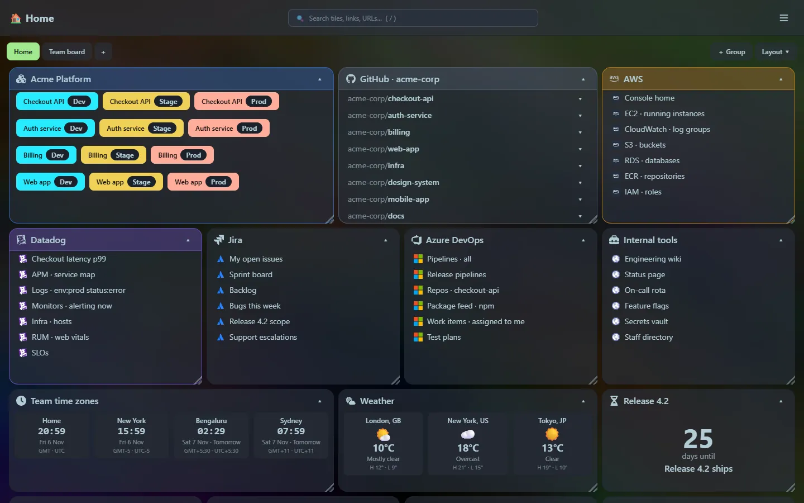

## Why I built this

> I started this project because at work, we had lots of links to dev builds, stage builds and production builds. As well as hundreds of GitHub repos, AWS URLs, Datadog queries, Jira and DevOps queries, pipelines and repository feeds, and internal tools. I wanted a way to organise all of this that was easy for me to use. The launcher and widgets seemed like a good addition, and it grew from there.

That is the whole origin story. Browser bookmarks stop working when you have hundreds of them: they are a flat list, they have no idea that "Billing, prod" and "Billing, stage" are the same service in two environments, and they cannot tell you the pull requests page of a repository without three more clicks.

## What it grew into

It started as a page of tiles. Then came the things I kept opening other tabs for, which turned into the **launcher** and the **widgets**:

- A **service tile** that shows each environment as a colour-coded button, with **Prod always red**, so you cannot click the wrong one by accident.
- A **GitHub tile** where each repository has a dropdown straight to its README, compare view, pull requests, issues and actions.
- A **search box** that matches titles and partial URLs, and a **launcher** that does the same from the keyboard.
- Small utilities that save a trip to a random website: JSON, JWT, regex, cron, cURL, hashes, QR codes, Markdown, diffs, timestamps, currency and unit conversion.

## Principles

**One small program.** Home Screen is one file. No installer, no runtime, no database server, no container required. Copy it somewhere, run it, point your browser at it. ({{metric.exe_size}}, all in.)

**Yours, and local.** It listens on your own machine only. There are no accounts and no cloud sync. Your tiles live in one SQLite file you can copy as a backup. See [Privacy and security](/guides/privacy-and-security/) for exactly which outside services are contacted, and when.

**Fast.** Preact and a few small libraries instead of a heavy framework: the whole web interface is about {{metric.js_gzip}} of script when compressed.

**Useful before pretty, but pretty enough.** It uses a dark theme out of the box, tiles can be glassy over a background image of your choice, and everything is reachable from the keyboard.

**Tools live next to the links.** The thing you were about to Google (decode this token, convert this timestamp, what does this cron do) is one shortcut away, and nothing you paste leaves your machine.

## Who it is for

Developers, SREs and anyone who works across many internal and external systems. If your bookmarks bar has a folder of folders, this is for you.

## Status

Home Screen is a **beta**. It is stable enough for daily use, and the documentation here describes what ships today. The [roadmap](/roadmap/) lists what might come next, and the [release notes](/releases/) track every version.

## Support

If Home Screen is useful to you, you can [buy me a coffee](https://buymeacoffee.com/rmalcomber).
