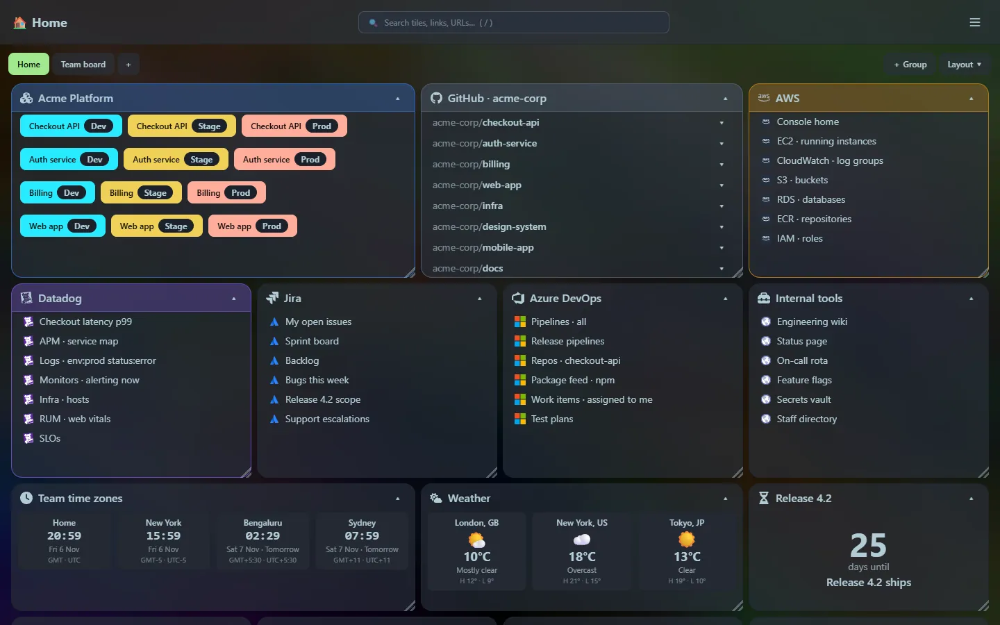
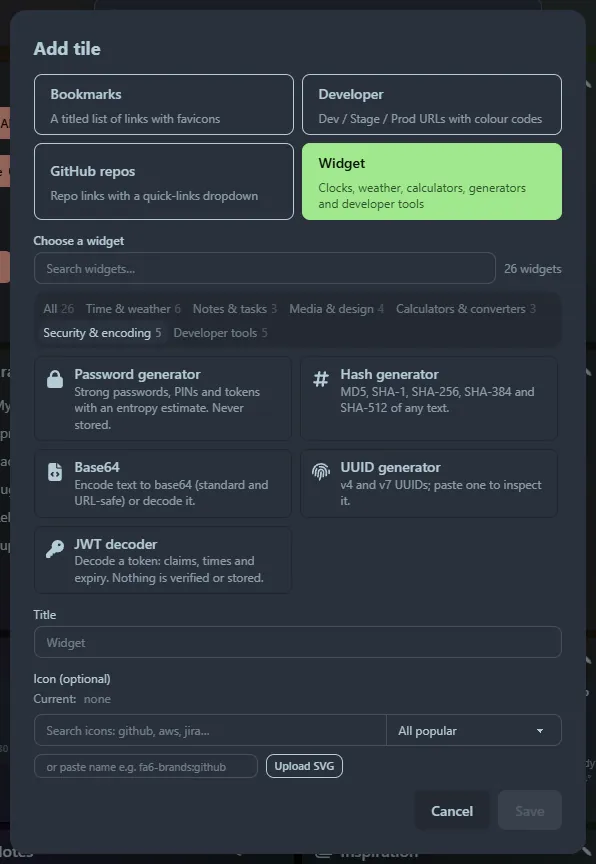

## The dashboard

- **Tiles you arrange**: drag a tile by its title bar, resize it from the corner, collapse it like an accordion. Positions are saved. [Layout](/guides/layout/)
- **Four tile types**: bookmarks, developer environments, GitHub repositories and widgets. [Tiles](/guides/tiles/)
- **Icons**: thousands of icons by name (Font Awesome brands, Simple Icons, Material and more) or your own SVG. [Icons](/guides/icons/)
- **Search**: filter tiles, link titles and partial URLs live. [Search](/guides/search/)
- **Import**: bring in a Chrome bookmarks export and sort links into tiles by domain. [Import bookmarks](/guides/import-bookmarks/)
- **Look and feel**: background colour or image, adjustable glass effect, auto-hiding title bar. [Settings](/guides/settings/)

## The launcher

Press <kbd>Ctrl</kbd>+<kbd>P</kbd> anywhere on the dashboard. It searches your tiles and links, remembers what you used, and recognises what you type:

| Type this | You get |
|---|---|
| `billing` | tiles, links and repositories that match |
| `(1299*12)/100`, `72 f to c`, `250 usd to gbp` | calculator, unit and currency converters |
| a `curl …` command | a tidy breakdown you can run |
| JSON, a JWT, CSV, Markdown | formatters, decoders and previews |
| `qr https://…`, `password 24`, `uuid`, `hash …` | generators |
| `>` | commands (add tile, import, settings) |

[Launcher overview](/launcher/) · [Search](/launcher/search/) · [All tools](/launcher/calculator/)

## Widgets

{{metric.widgets}} widgets in six categories, picked from a searchable gallery: clocks and weather for several places at once, notes, a keyboard-driven todo list, a countdown, an interval timer, a carousel, a colour picker, and **every launcher tool** as a tile of its own. [Widgets](/widgets/)

## Built to stay out of your way

- **Single binary**: {{metric.exe_size}}, nothing to install first. [Metrics](/reference/metrics/)
- **Private by design**: local only, no accounts, secrets are never written to disk unless you copy them into history. [Privacy](/guides/privacy-and-security/)
- **Keyboard first**: every launcher tool and the todo widget are driven from the keyboard. [Shortcuts](/guides/shortcuts/)
- **Honest about the network**: icons, favicons, weather and currency rates come from named public services only when used.
- **Easy to back up**: one SQLite database next to the program. [Data and backup](/guides/data-and-backup/)
- **Extensible**: adding a widget or a launcher tool is one small module. [Extending](/reference/extending/)

## Runs anywhere

Builds for Windows, Linux (Intel/AMD and Arm) and macOS (Apple silicon and Intel), plus a small Alpine-based Docker image with Compose files for running behind Caddy with HTTPS and a password. See [Install](/getting-started/install/) and [Docker](/getting-started/docker/). A locked mode that disables editing is [on its way](/getting-started/locked-mode/).
