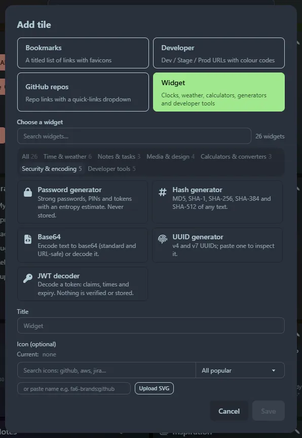
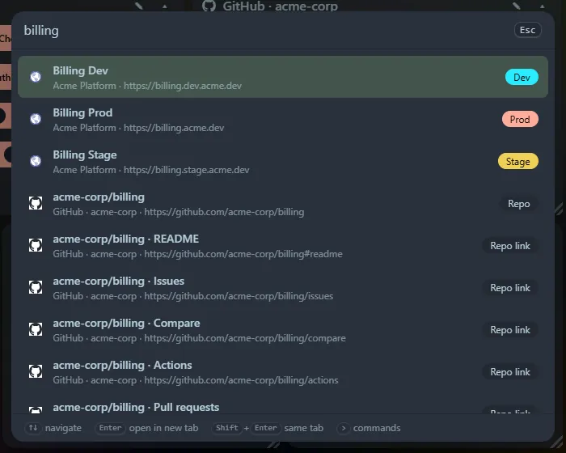

A quick tour that takes about five minutes.

## 1. Add a tile

Open the **☰** menu at the top right and choose **＋ Add tile**. Pick a type:

- **Bookmarks**: a titled list of links.
- **Developer**: services with Dev, Stage and Prod links (Prod is red).
- **GitHub repos**: repositories with a quick-links dropdown.
- **Widget**: pick from the gallery, filtered by category or search.

Give it a title and, if you like, an icon, then **Save**. The tile appears at the bottom; drag it by its title bar wherever you want.

## 2. Import what you already have

If your browser bookmarks are the thing you are trying to replace, use **☰ → Import Bookmarks**. Links are grouped by domain so you can send each group to a tile in a few clicks. See [Import bookmarks](/guides/import-bookmarks/).

## 3. Try the launcher

Press <kbd>Ctrl</kbd>+<kbd>P</kbd>. Start typing a tile or link name. Then try:

- `1+1`
- `72 f to c`
- `uuid`
- `>` to see the commands

## 4. Make it yours

**☰ → Settings** lets you pick a background colour or image, turn the title bar auto-hide on or off, and adjust the glass effect. See [Settings](/guides/settings/).

## 5. Make it your home page

Follow [Set it as your home page](/getting-started/chrome-home-page/) so it opens when you start your browser.
