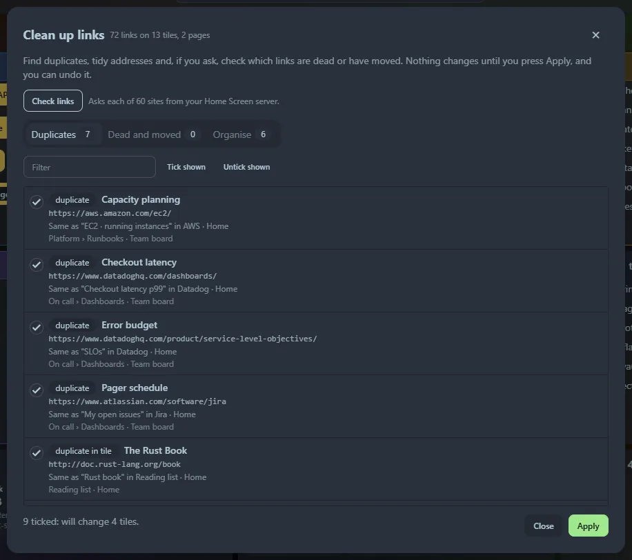

Over time a dashboard collects the same link three times, links that died years ago and addresses full of tracking junk. **☰ → Clean up links…** (also in **Settings → Links**, and as the `>cleanup` command in the launcher) finds them across **every page**, shows you what it found, and changes only what you tick.

Nothing is changed until you press **Apply**, and you can **Undo last clean up** afterwards (see below).

## Duplicates

Links that go to the same place are listed, and every copy except the first is offered for removal (ticked). Two links count as the same when they differ only in:

- `http` or `https` (the `https` one is kept),
- a leading `www.`,
- a trailing slash or a `#fragment`,
- the default port,
- tracking parameters such as `utm_source`, `fbclid` and `gclid`, or the order of other parameters.

This works across tiles, groups and pages. The same address in the dev, stage and prod boxes of a developer tile is *not* a duplicate.

## Dead and moved links

Press **Check links**. Your Home Screen **server** asks each site once (browsers are not allowed to) and sorts the answer. Nothing is checked until you press the button, five sites at a time, with a progress bar and **Stop**.

| Result | Meaning | Default |
|---|---|---|
| **Moved** | The site says the page moved permanently, or `http` now goes to `https`. The new address is shown. | Ticked: *update the link*, unless it looks like the page is gone |
| **Redirects** | A temporary redirect. Usually fine to leave. | Not ticked |
| **Not working** | Not found (404, 410), the name does not exist, the connection is refused or the security certificate is invalid. | Not ticked: *remove the link* |
| **Blocked or needs sign-in** | The site refused the request (`401`, `403`, `429`). Many sites refuse automated checks even though they work in a browser. | Not ticked |
| **Too slow**, **Server error** | No answer in 15 seconds, or the server failed. These are often temporary. | Not ticked |

A link is never removed just because a check failed: sites go down for an hour. Two cases are marked **check this one** and are not ticked, because the move may mean the page is gone: a deep link that now redirects to the site's front page, and a link that redirects to a sign-in page.

Addresses on your own network (`localhost`, `192.168.x.x`, `10.x.x.x`, `.local` names and single-word host names) are not checked: the server cannot tell you what your browser would see.

Use **Ignore** on a row to stop listing a link (for example a site that always blocks checks); **Stop ignoring** brings them back. **Check again** clears the answers and asks again.

## Organise

Tidy-ups that need no network:

- **Tracking parameters**: `https://example.com/page?utm_source=news&id=7` becomes `…/page?id=7` (ticked).
- **No title**: a link with an empty title, or the address as its title, gets the site name (ticked).
- **Group by site**: four or more links to one site spread over several tiles can move into a new tile named after the site (not ticked).
- **Empty tile**: a bookmarks tile with no links (not ticked).
- **Not a web address**: a link that is not `http` or `https` (not ticked).

## Applying and undoing

Tick what you want (the tabs have **Tick shown** and **Untick shown**, and a filter), and the footer says what will happen: *will change 3 tiles, delete 1 tile*. **Apply** asks once more, then makes the changes tile by tile.

**Undo last clean up** puts every edited tile back as it was, removes tiles the clean up created, and brings back deleted ones. It stays available while the page is open, even if you close and reopen the dialog; reloading the page forgets it. Because there is no history of dashboard changes, back up `home_screen.db` before a large clean up (see [Data and backup](/guides/data-and-backup/)).

## Good to know

- Link checking only works when this page is opened via `localhost`, `127.0.0.1` or a name in `--allowed-hosts`, like the [curl runner](/launcher/curl/). See [Options](/getting-started/options/).
- The sites you saved see a request from your Home Screen server (a `HEAD`, then a `GET` if the site does not like `HEAD`), identified as `HomeScreen-LinkCheck`. See [Privacy and security](/guides/privacy-and-security/).
- Links in developer tiles and GitHub tiles are checked and can be updated, but not removed: edit those tiles yourself.
- The time of the last check is kept in your settings, along with the list of ignored links.
