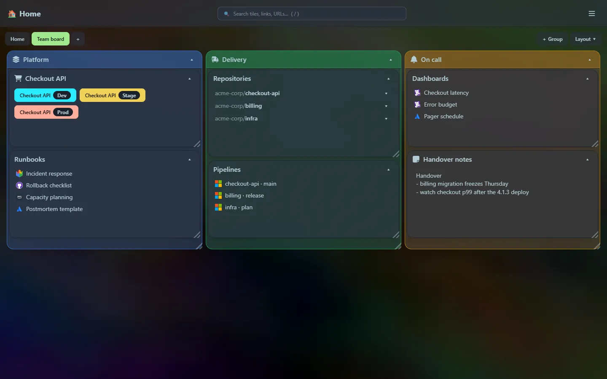
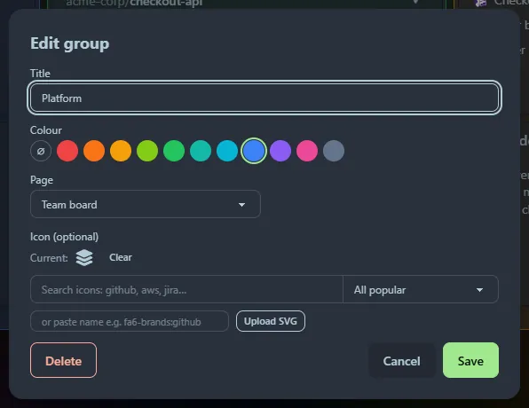
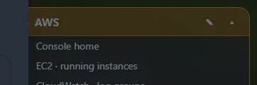

## Groups

A **group** is a box that holds other tiles. It moves, resizes and collapses like any tile, and everything inside travels with it. Use groups to keep related tiles together: all the tiles for one product, one team, or one part of your day.

### Make one

- **＋ Group** above the grid (next to **＋ Add tile**), **☰ → ＋ Add group**, or `> Add group` in the [launcher](/launcher/commands/).
- Give it a title, pick a colour and, if you like, an icon.
- Add tiles to it with the **＋** button that appears on the group's title bar, or choose the group in a tile's **Inside group** list when you add or edit the tile.

### Move tiles in and out

Drag a tile's title bar over a group and a dashed outline shows where it will land. Let go to drop it in. Drag it back onto the page to take it out. You can also use the **Page** and **Inside group** lists in the tile editor, which is handy on a touch screen.

### How a group lays out its tiles

- A group has **its own grid, as many columns wide as the group itself**. A group six columns wide holds tiles up to six columns wide, and a tile that is wider than the group is narrowed to fit.
- Tiles inside are moved, resized and pushed around in exactly the same way as on the page. See [Layout](/guides/layout/).
- A group **grows to contain its tiles** and never shrinks below them. If you want it smaller, shrink or move the tiles first.
- **Collapsing a group** hides everything inside it and leaves just the title bar. Opening it again restores the arrangement.
- Groups go **one level deep**: a group cannot sit inside another group.
- [Search](/guides/search/) looks inside groups. A group that holds a match opens up and highlights it, and the [launcher](/launcher/search/) finds tiles inside groups, telling you which group they are in.

### Deleting a group

Deleting a group deletes **the tiles inside it** too. Home Screen tells you how many before it asks you to confirm. To keep the tiles, drag them out onto the page first.

## Colours

Every tile, and every group, can have a colour. Choose it in the tile editor from a palette of eleven (red, orange, amber, lime, green, teal, cyan, blue, violet, pink and slate), or pick the crossed-out circle for no colour.

- A coloured **tile** gets a tinted title bar and border. The inside stays the normal tile colour, so text is easy to read on any [background](/guides/settings/).
- A coloured **group** is a tinted box, so a coloured group stands out from a plain one at a glance.
- Colour is separate from the red **Prod** button on [developer tiles](/guides/tiles/#developer): that is always red.

The palette is tuned to sit well on the `dim` theme. If you want a single, unmistakable accent, `blue` and `amber` work well against most backgrounds.

## Editing without the clutter

The ✎ edit button, and a group's ＋ button, stay out of the way until you **point at the title bar**. The ▾ collapse button is always visible. On touch screens, where there is no pointer to hover, the buttons are always shown.

