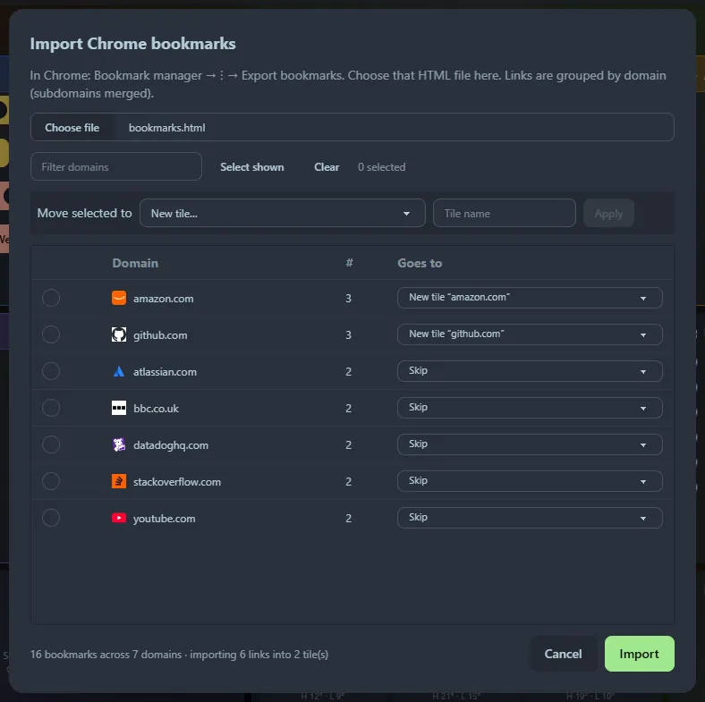

**☰ → Import Bookmarks** turns a Chrome export into tiles.

1. In Chrome open the Bookmark Manager (<kbd>Ctrl</kbd>+<kbd>Shift</kbd>+<kbd>O</kbd>), then **⋮ → Export bookmarks**. This saves an HTML file.
2. In the dialog, choose that file. Links are **grouped by domain with subdomains merged**: `docs.github.com` and `github.com` land together, and multi-part suffixes such as `bbc.co.uk` are handled.
3. Decide where each group goes. Use the dropdown on a row, or tick several rows and use **Move selected to**: a new tile with a name you choose, a tile per domain, or an existing bookmarks tile. Everything starts as *Skip*, so you only import what you pick.
4. Click **Import**. Duplicate URLs are skipped, and groups sent to the same new tile name are merged into one tile.

:::tip
Start by tiling your biggest domains (GitHub, AWS, Jira), then use **A tile per domain** for the long tail and clean up later.
:::
