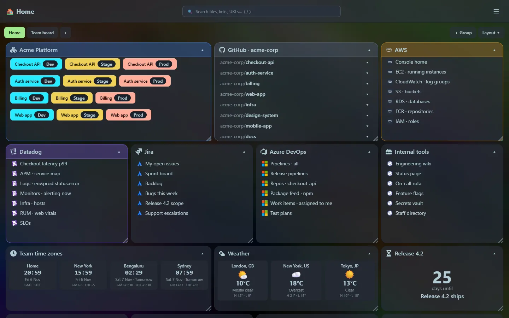
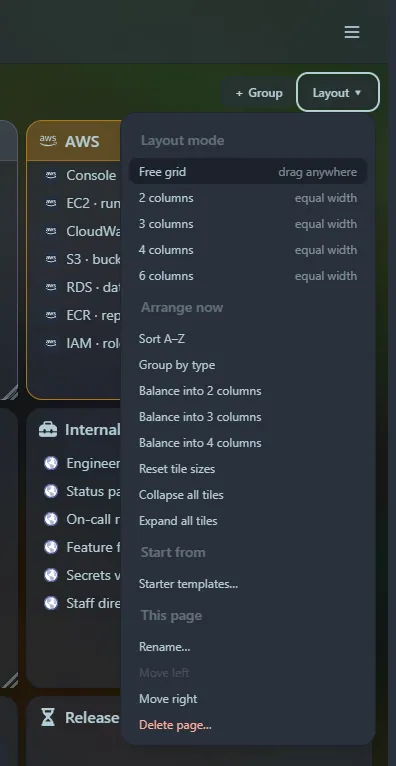

- **Move** a tile by dragging its title bar.
- **Resize** it with the handle in the bottom-right corner.
- **Collapse and expand** it by clicking its title bar or the ▾ button. It behaves like an accordion: collapsed tiles shrink to their header and the tiles below move up.

The grid is **12 columns** wide. Dropping a tile on top of another pushes the other tile down, and gaps close up automatically. Positions, sizes and collapsed state are saved to the database as soon as you let go. Tiles can also live [inside groups](/guides/groups-and-colours/) and on separate [pages](/guides/pages-and-templates/).

:::tip
Make a tile wider if its content wraps. For example, a developer tile with several services reads best at five or six columns, so each service's Dev, Stage and Prod buttons sit on one line.
:::

## Layout modes

Each [page](/guides/pages-and-templates/) has its own mode, chosen from the **Layout** menu above the grid (or `> Layout: …` in the launcher):

| Mode | How it behaves |
|---|---|
| **Free grid** (default) | Tiles go where you drop them, at any width. |
| **2, 3, 4 or 6 columns** | The page is split into equal columns. Every tile is exactly one column wide and snaps to the column you drop it in; you only choose the height. Tiles stack down each column. |

Switching to a column mode **spreads your tiles over the columns** straight away, putting each one in the shortest column so they come out even. Switching back to the free grid keeps those positions and lets you move things freely again.

New tiles are placed for you: in free mode at the bottom, in a column mode in the shortest column.

## Arrange now

The **Layout → Arrange now** commands tidy a page in one click. They work on the page's top-level tiles and groups (tiles inside a group keep their places), and afterwards you can still drag anything.

| Command | Result |
|---|---|
| **Sort A–Z** | Tiles in title order, filling each row from the left. |
| **Group by type** | Groups first, then developer, GitHub, bookmarks and widgets, each sorted by title. |
| **Balance into 2, 3 or 4 columns** | Tiles dealt out into equal columns, each into the shortest one, at column width. |
| **Reset tile sizes** | Every tile back to the default size for its type (a widget's own default for widgets). |
| **Collapse all / Expand all tiles** | Fold or unfold everything on the page. |

These are also available as `> Arrange: …` commands in the [launcher](/launcher/commands/).

## Phones and narrow windows

Under 640 pixels, tiles stack in a single column in their current order, groups stack their tiles the same way, and dragging is turned off. Tap a title bar to collapse or expand.
