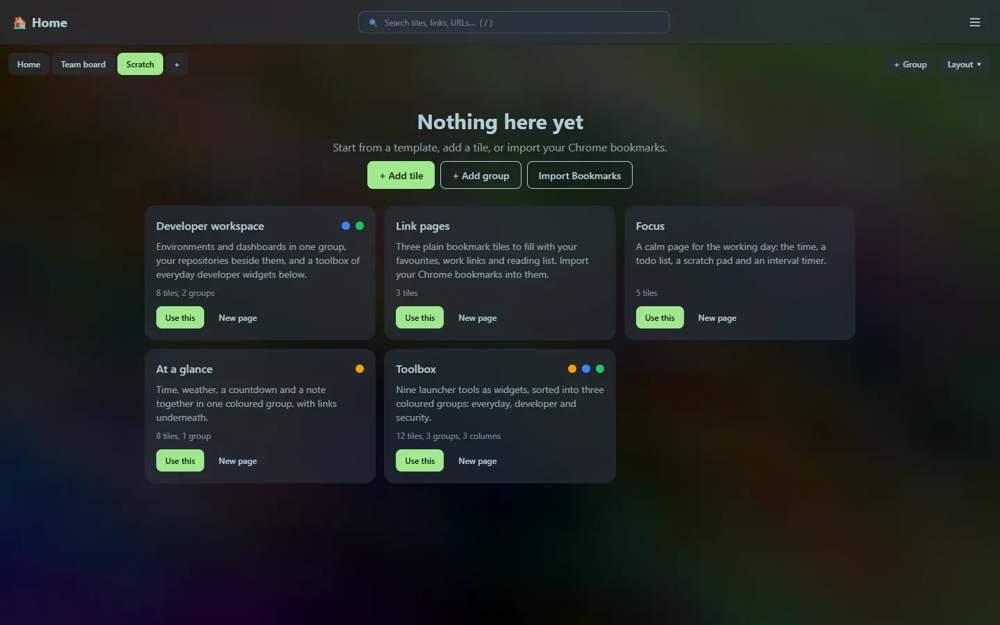
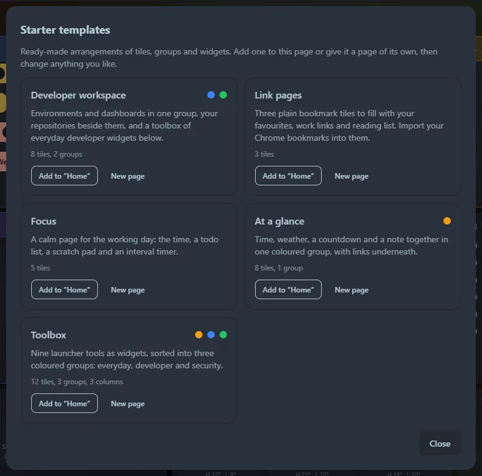

## Pages

A **page** is a separate dashboard with its own tiles, groups and [layout mode](/guides/layout/#layout-modes). Use pages for the way you work: a *Work* page and a *Home* page, one per project, or a busy *Everything* page next to a calm *Focus* one.

The pages appear as tabs above the grid. Your choice is remembered per browser, so each machine opens on the page you used last.

| To | Do this |
|---|---|
| Switch page | Click its tab, or `> Go to page: …` in the [launcher](/launcher/commands/) |
| Add a page | **＋** after the last tab |
| Rename the current page | Double-click its tab, or **Layout → Rename…** |
| Reorder pages | **Layout → Move left / Move right** |
| Delete the current page | **Layout → Delete page…** (it deletes the page's tiles; the last page cannot be deleted) |
| Move a tile to another page | Choose the page in the tile editor |

The [launcher](/launcher/search/) searches **every page** and switches to the right one when you pick a result. Once you have more than one page, results show the page name. The search box above the grid filters the current page only.

:::note
Pages belong to one database. Different *people* using one Home Screen is on the [roadmap](/roadmap/) as profiles.
:::

## Starter templates

A **template** is a ready-made arrangement of tiles, groups and widgets, so a new or empty page starts from something useful instead of nothing.

An empty page offers the templates straight away. At any other time open **Layout → Starter templates…** (or `> Starter templates`, or **☰ → Starter templates**).

For each template choose:

- **Use this** (or **Add to “page”** when the page already has tiles): adds its tiles below what is there.
- **New page**: gives the template a page of its own, in the layout mode the template was designed for.

| Template | What you get |
|---|---|
| **Developer workspace** | An *Environments* group (a developer tile and a links tile), a GitHub repositories tile, a *Toolbox* group with the JSON formatter and Base64 widgets, and a clock. |
| **Link pages** | Three bookmark tiles (Favourites, Work, Reading list) ready for [importing your Chrome bookmarks](/guides/import-bookmarks/). |
| **Focus** | Clock, todo list, notes, an interval timer and a countdown. |
| **At a glance** | A coloured group with clock, weather, countdown and notes, plus three link tiles. |
| **Toolbox** | Nine [launcher tools as widgets](/widgets/tool-widgets/) in three coloured groups (everyday, developer, security). As a new page it uses three-column mode. |

Templates are only a starting point. Every tile they create is an ordinary tile: rename it, recolour it, move it, delete it. The example links and addresses (such as `dev.example.com`) are placeholders for you to replace.
