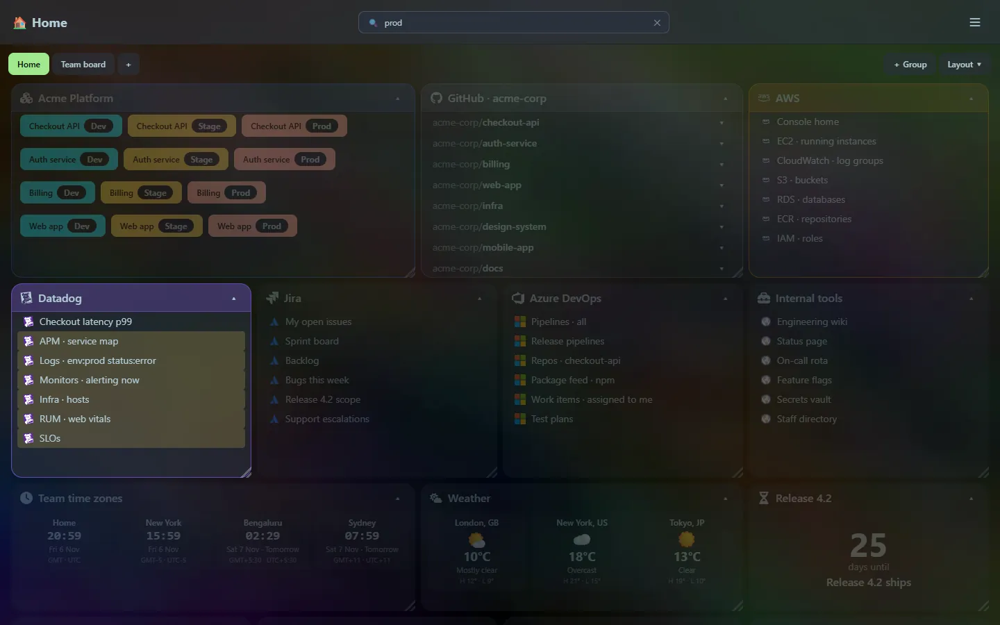

There are two ways to search, and they complement each other.

## The search box

The search box in the top bar (press <kbd>/</kbd> to focus it) filters the dashboard **live** by tile title, link title and **partial URL**. Matching tiles open up and the matching links are highlighted; the other tiles fade out. Press <kbd>Esc</kbd> to clear it.

## The launcher

<kbd>Ctrl</kbd>+<kbd>P</kbd> opens the [launcher](/launcher/), which searches the same things as a list you can jump from, and also recognises calculations, conversions and tool input. See [Launcher search](/launcher/search/).
