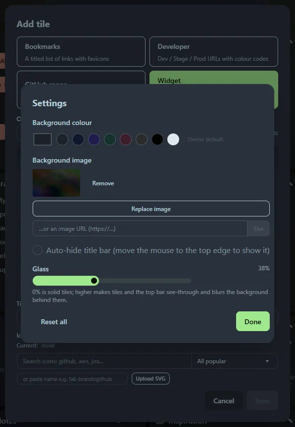

Open **☰ → Settings**. Changes apply instantly and are saved.

- **Background colour**: a colour picker and swatches, or **Theme default** to go back to the built-in dim theme colour.
- **Background image**: upload an image or paste a URL. It covers the page and stays fixed while you scroll.
- **Glass**: a 0 to 100 % slider. At 0 % tiles and the top bar are solid; higher values make them see-through and blur the background behind them.
- **Auto-hide title bar**: on by default. Move the mouse to the top edge to bring the bar back.
- **Links → Clean up links…** opens [Clean up](/guides/clean-up/).
- **Reset all** clears the colour, image and glass settings.

Uploaded images accept PNG, JPEG, GIF, WebP and AVIF, and are stored in the database.
