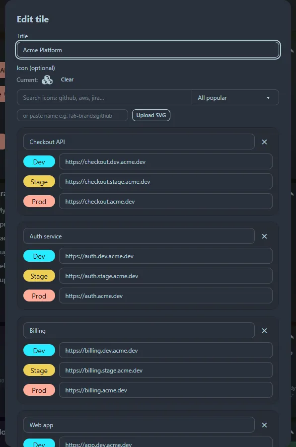

Create a tile from **☰ → ＋ Add tile**. Click the ✎ on a tile to edit or delete it. There is no limit on how many tiles you have.

## Bookmarks

A titled list of links. Each row shows the site's favicon and the link title. Add as many links as you like.

## Developer

For services that exist in several environments. Each **service** has a name and optional **Dev**, **Stage** and **Prod** addresses, shown as coloured buttons labelled `{Name} {Env}`: Dev is blue, Stage is amber and **Prod is red**. Use **+ Add service** to put several services in one tile.

## GitHub repos

A list of repositories. Each row links to the repository and has a **▾** dropdown with **Code, README, Compare, Pull requests, Issues** and **Actions**.

Set an optional **default owner** (for example `acme-corp`) and then enter only repository names. `owner/repo` and full GitHub URLs also work and override the default owner.

## Widget

Pick from the [widget gallery](/widgets/): clocks, weather, calculators, generators and developer tools. The title and icon fill in for you when you pick one, and the widget's own settings appear underneath.

## Collapse and expand

Click a tile's title bar, or the ▾ button, to collapse it to just its header. The tiles below move up to fill the space. See [Layout](/guides/layout/).
