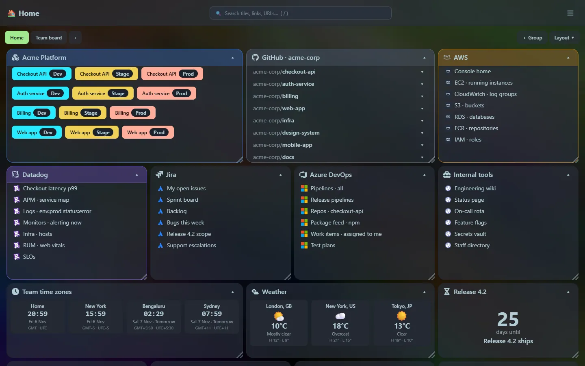
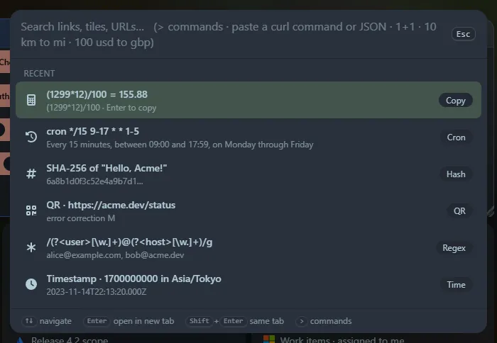

## What is Home Screen?

Home Screen is a start page for your browser, built for people who juggle a lot of links. It is a **grid of tiles** you arrange yourself, a **launcher** (<kbd>Ctrl</kbd>+<kbd>P</kbd>) that searches everything and doubles as a toolbox, and a set of small **widgets**. It runs as a single program on your own machine and keeps everything in a local database.

- **Organise** dev, stage and production URLs, GitHub repositories, AWS consoles, Datadog queries, Jira and DevOps filters, pipelines and internal tools into tiles you can drag, resize and collapse.
- **Find anything** with one search box, then jump straight to a link, a repository's pull requests, or a tool.
- **Do small jobs without leaving the page**: calculate, convert units and currencies, decode a JWT, format JSON, test a regex, preview Markdown, generate a QR code or a password, and more. Every one of those tools is also a widget.
- **Stay private**: it only listens on your machine, has no accounts, and sends nothing to a server of ours.

## At a glance

| | |
|---|---|
| **Size of the program** | {{metric.exe_size}} for the whole app, web interface included |
| **Start-up** | about {{metric.startup}} to be ready |
| **Memory at rest** | about {{metric.idle_memory}} |
| **Widgets** | {{metric.widgets}} (including every launcher tool) |
| **Launcher tools** | {{metric.tools}}, plus search and commands |
| **Dependencies you need** | none: no runtime, no installer, no database server |

See [the full metrics](/reference/metrics/) and [how it is built](/reference/tech-stack/).

## Where to next?

- New here? Read [why it exists](/about/) and the [feature tour](/features/).
- Ready to try it? Follow [Install](/getting-started/install/) and [set it as your home page](/getting-started/chrome-home-page/).
- Looking for a particular tool? Browse [the launcher](/launcher/) or [the widgets](/widgets/).
- Want to know what is coming? See the [roadmap](/roadmap/) and the [release notes](/releases/).

:::note[Beta software]
Home Screen is in beta. It works and is used daily, but features are still changing. The [release notes](/releases/) say what changed in each version. Source and issues live on [GitHub]({{repo}}) (temporary link).
:::
