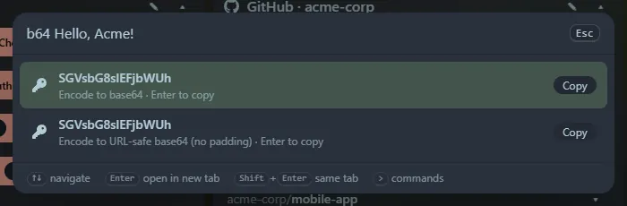

Type `b64 <text>` (or `base64 <text>`). It offers the encodings, and if your text is valid base64 it also decodes it, with the decoded text first.

- **Standard** and **URL-safe** (no padding) encodings.
- Decoding accepts standard or URL-safe base64, with or without padding. Line breaks (wrapped base64) are ignored.
- Text containing spaces is never treated as base64.
- If the decoded data is not text, it is offered as **hex**.
- Unicode is handled correctly.

It only triggers with the `b64` prefix, so ordinary searches are never mistaken for base64. <kbd>Enter</kbd> copies the selected result, which is saved in **Recent**.
