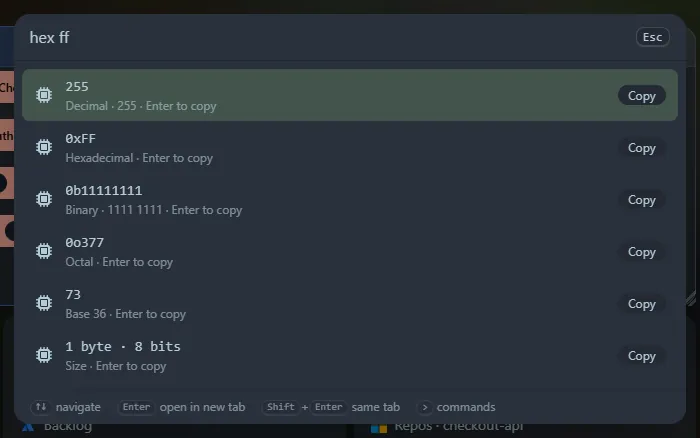

Convert a number to every base at once, turn a size into every unit, or evaluate a bit expression and see which bits are set. Everything uses exact big integers, so large values do not lose digits.

## Numbers

| Type | Reads |
|---|---|
| `hex ff` | `ff` as hexadecimal |
| `bin 1010`, `oct 755`, `dec 255` | Binary, octal and decimal |
| `base 255` | A number with an optional prefix (`0x`, `0b`, `0o`) |
| `base 36 zz` | `zz` in any base from 2 to 36 |
| `0xFF`, `0b1010`, `0o17` | A bare prefixed number, with no command word |

Underscores are allowed (`0b1010_1010`), and so is a minus sign. You get decimal (also with thousands separators), hexadecimal, binary (also grouped by four), octal, base 36 and the size in bytes and bits. For a **negative** number the two's complement is shown for the widths it fits in: 8, 16, 32 and 64 bits.

A bare `255` is deliberately not a trigger, so ordinary numbers still go to the [calculator](/launcher/calculator/).

## Byte sizes

`bytes 1536000` or `bytes 1.5 GiB`: you get the exact byte count, a human-readable form in both **SI** (powers of 1000: KB, MB, GB) and **IEC** (powers of 1024: KiB, MiB, GiB), every unit that is not tiny, and the number of bits. Units are `b`, `kb`, `mb`, `gb`, `tb`, `pb` and `kib`, `mib`, `gib`, `tib`, `pib`; a bare `k`, `m`, `g` or `t` means the binary size. To convert between two units directly, use the [unit converter](/launcher/units/).

## Bits

`bits <expression>` calculates with the C operators: `|` `^` `&` `<<` `>>` `~` `+` `-` `*` `/` `%` and parentheses, on numbers in any base. Examples: `bits (1<<3)|(1<<5)`, `bits 0xF0 & 0x3C`, `bits ~0`.

`bits set 0 2 5` builds a value from bit positions (0 is the lowest bit). The result is shown in every base, with a row listing the **bits that are set**.

<kbd>Enter</kbd> copies a row. The tools are also widgets: **Number base converter**, **Byte size converter** and **Bit calculator**.
