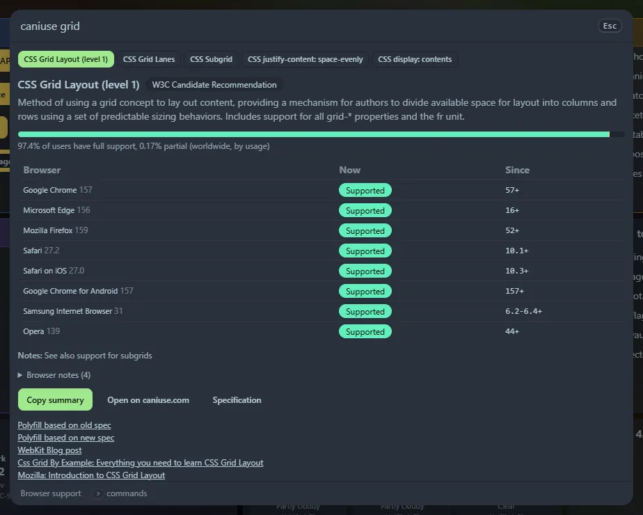

Type `caniuse` (or `ciu`) and the name of a web feature, such as `grid`, `flexbox gap`, `webp` or `fetch`. A panel shows which browsers support it, and since when.

## What you see

- Up to eight **matches** as buttons, best first. Click one to switch. Words are matched against feature names, keywords and descriptions, and every word must match.
- **Global support**: the share of users whose browser fully supports the feature, and the share with partial support, as a bar.
- A **table** for Chrome, Edge, Firefox, Safari, Safari on iOS, Chrome for Android, Samsung Internet and Opera: the current version, whether it is supported, partly supported (with a note), needs a prefix, is off by default or is not supported, and the **version that first supported it**.
- The specification status, notes, a link to the specification and other reading, **Copy summary** (a one-line summary you can paste into a pull request) and **Open on caniuse.com**.

## Where the data comes from

The data is the public [Can I use](https://caniuse.com) dataset (licensed CC BY 4.0), from the `Fyrd/caniuse` repository on GitHub.

- The **first** search downloads it (about 450 KB compressed) from `raw.githubusercontent.com`. Your browser does this, not the server.
- It is then **kept in your browser's cache** and used for a week; after that it is refreshed. If you are offline, the saved copy is used and the panel says so.
- The cache needs a secure context, which `localhost` is. If you open Home Screen by a plain `http://` address on your network, the data is downloaded again in each browser session.
- Nothing about what you search for is sent anywhere: the search runs in your browser on the downloaded data.

The data is not part of the program, so the program stays small. It is also a widget, **Can I use**.
