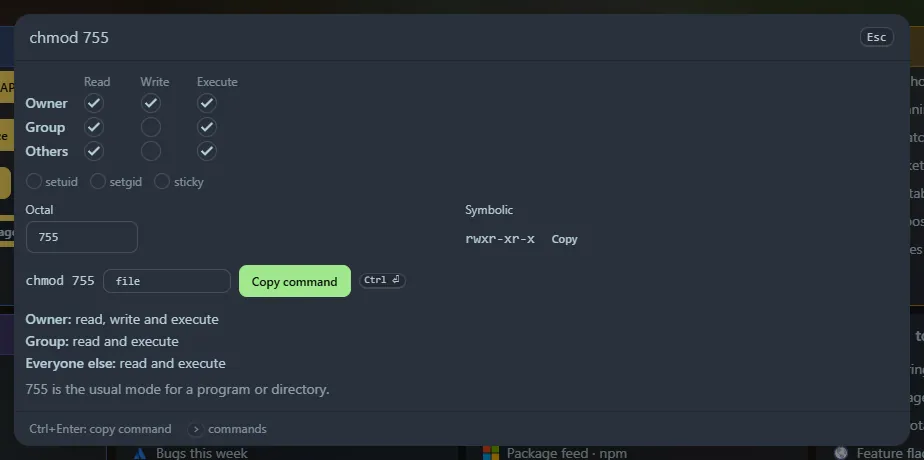

Type `chmod` for an editor, or `chmod 755` to start from a mode. Tick the boxes or type the octal, and copy the command.

## The editor

- A **grid** of read, write and execute for owner, group and others, plus **setuid**, **setgid** and **sticky**.
- The **octal** field (type `644`, `0755` or `4755`) and the **symbolic** form (`rwxr-xr-x`), each kept in step with the boxes.
- A **command** such as `chmod 755 file`, with a box for the file name. <kbd>Ctrl</kbd>+<kbd>Enter</kbd> copies it.
- Plain English underneath: *Owner: read, write and execute*, and a note for well-known modes (`644` is the usual mode for a file, `777` is rarely a good idea).

## What you can type

| Type | Means |
|---|---|
| `chmod 755`, `chmod 0644`, `chmod 4755` | An octal mode |
| `chmod rwxr-xr-x`, `chmod -rw-r--r--` | A symbolic mode (an `ls -l` string, with or without the file type) |
| `chmod u+x,g-w,o=r` | Symbolic clauses, applied to nothing (`000`) |
| `chmod 644 u+x` | A mode followed by clauses |
| `umask 022` | The permissions new files and directories get |

Clauses work like `chmod`: `u`, `g`, `o` and `a` for who, `+`, `-` and `=` for what, and `r`, `w`, `x`, `X`, `s`, `t` or another class (`g=u`). No `umask` is applied when the "who" is left out; everything is treated as `a`.

## umask

`umask 022` shows `644` for new files (they start from `666`) and `755` for new directories (they start from `777`). Any three octal digits work.

Everything is worked out in your browser. Copied commands are saved in **Recent**. The tools are also widgets: **chmod calculator** and **umask calculator**.
