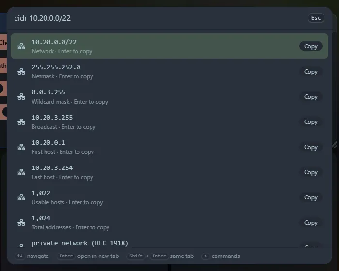

Paste a network or an address and see what it covers. You do not need a command word for an address or a CIDR block: `10.0.0.0/24`, `192.168.1.5` and `2001:db8::/32` are recognised on their own. You can also start with `cidr`, `ip` or `subnet`.

## What you get

For an **IPv4** block: the address you typed (when it has host bits), the network in CIDR form, netmask, wildcard mask, broadcast address, first and last usable host, number of usable hosts, total addresses, the **type** (private, loopback, link-local, CGNAT, multicast, documentation, public...), the address as a number, and the address and mask in binary. `/31` links (two hosts) and `/32` (one address) are handled as RFC 3021 describes.

For **IPv6**: the network, the last address, the total number of addresses, the fully expanded form, the type (global unicast, unique local, link-local, loopback, IPv4-mapped...) and, for an IPv4-mapped address, the IPv4 address inside.

A mask can be written as a prefix (`/24`) or, for IPv4, as a netmask (`10.0.0.0/255.255.255.0`). Addresses with leading zeros (`010.1.1.1`) are refused, because tools disagree on whether they are octal.

## Questions

| Type | Answers |
|---|---|
| `cidr 10.0.0.5 in 10.0.0.0/24` | Whether the address is inside the network (`cidr 10.0.0.0/24 contains 10.0.0.5` works too) |
| `cidr 10.0.0.0/24 overlaps 10.0.0.128/25` | Whether two networks are the same, one holds the other, or they share nothing (`vs` and `and` work too) |
| `cidr 10.0.0.0/24 split 26` | The four `/26` subnets (the first 256 are listed, with a count of the rest) |

<kbd>Enter</kbd> copies a row. Everything is worked out in your browser, and the tool is also a widget.
