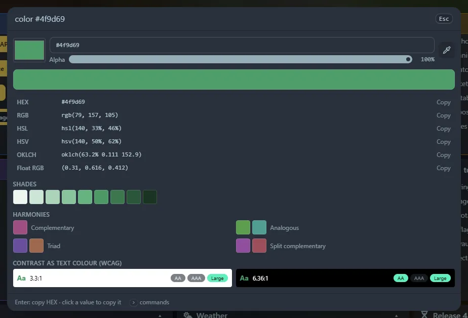

Type `color` (or `colour`, or `picker`), or type a colour directly: `#ff8800`, `rgb(255, 136, 0)`, `hsl(32 100% 50%)`, or `color rebeccapurple`. Any CSS colour name works, as does modern syntax such as `oklch(…)`.

## In the panel

- The native colour picker, a text box that accepts any of those spellings, an alpha slider and an **eyedropper** button (Chrome's EyeDropper: click it, then click any pixel on screen).
- Every format, **click to copy**: HEX (and HEX + alpha), RGB, HSL, HSV, OKLCH and float RGB (`(1, 0.533, 0)`, handy for shaders).
- Nine **shades**, and **harmonies** (complementary, analogous, triad, split complementary). Click any swatch to make it the current colour.
- **WCAG contrast** of the colour as text on white and on black, with AA, AAA and large-text badges.

<kbd>Enter</kbd> copies the HEX. Copied colours go to **Recent** with a colour swatch.

## Also a widget

The [Colour picker widget](/widgets/colour-picker/) keeps a colour on your dashboard with a *Recent* row of copied colours.
