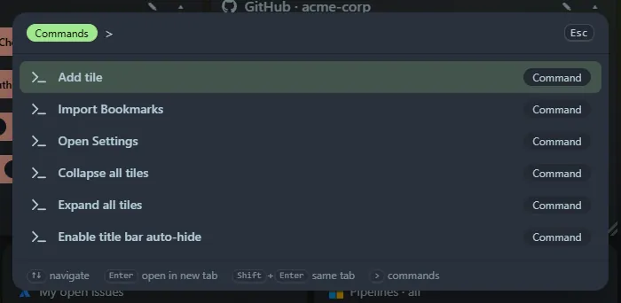

Start with `>` (or press <kbd>Ctrl</kbd>+<kbd>Shift</kbd>+<kbd>P</kbd>, which opens the launcher with `>` already typed) to run commands.

| Command | What it does |
|---|---|
| Add tile | Opens the add-tile dialog |
| Add group | Opens the add-group dialog |
| Starter templates | Opens the [starter templates](/guides/pages-and-templates/#starter-templates) |
| Arrange: Sort A–Z, Group by type, Balance into 2, 3 or 4 columns, Reset tile sizes | [Auto-arranges](/guides/layout/#arrange-now) the current page |
| Layout: free grid, 2, 3, 4 or 6 columns | Switches the current page's [layout mode](/guides/layout/#layout-modes) |
| Go to page: *name* | Switches to that page (one command per page) |
| Import Bookmarks | Opens the Chrome bookmarks import |
| Clean up links | Opens [Clean up](/guides/clean-up/): duplicates, dead and moved links, tidy-ups |
| Open Settings | Opens settings |
| Collapse all tiles | Collapses every tile to its header |
| Expand all tiles | Expands every tile |
| Enable or disable title bar auto-hide | Toggles the auto-hiding top bar |

Type after the `>` to filter, for example `> coll`.
