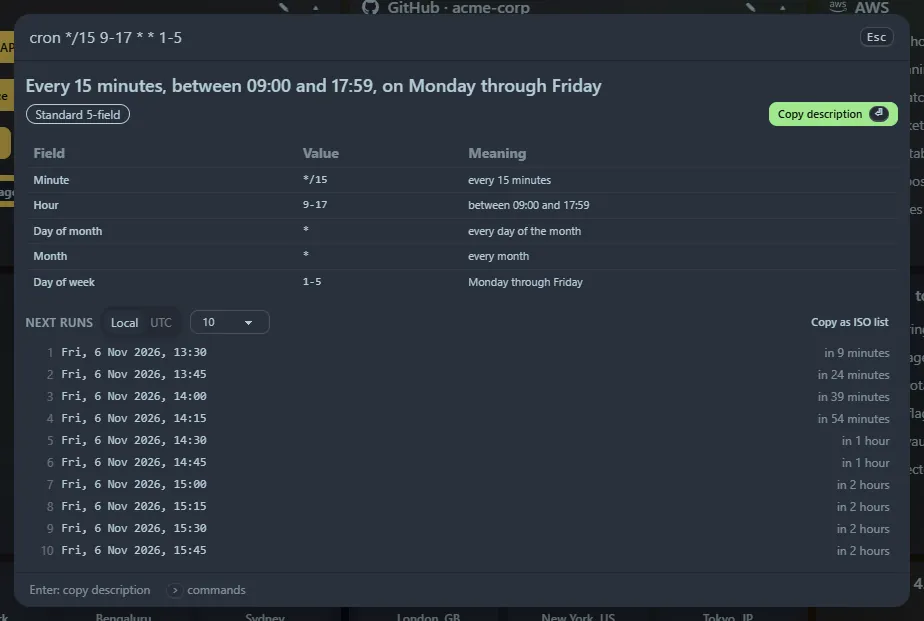

Paste a cron expression, or type `cron <expression>` (also `crontab`). A bare expression such as `0 9 * * 1-5` or a macro such as `@daily` is recognised on its own, as long as it is clearly cron (it has a `*` or `/` and every field is valid).

## What you get

- A **plain-English description**: `*/15 9-17 * * 1-5` becomes "Every 15 minutes, between 09:00 and 17:59, on Monday through Friday".
- A **field-by-field table** with each field's meaning.
- The **next 5, 10 or 25 run times**, in your local time or UTC, each with a relative time ("in 3 hours").
- Precise **error messages** that name the bad field, for example "Minute: 61 is out of range for minute (0–59)".

## Supported syntax

`*`, lists (`1,15`), ranges (`9-17`), steps (`*/5`, `10-40/10`, `5/15`), month and weekday names (`JAN`, `MON-FRI`), `?`, the macros `@yearly @monthly @weekly @daily @midnight @hourly` and `@reboot`, and the Quartz specials `L` (last day), `LW`, `L-3`, `15W` (nearest weekday), `5L` (last Thursday) and `6#3` (third Friday).

When both day-of-month and day-of-week are set, classic cron runs on **either** match, and the panel says so.

## Five, six and seven fields

Five fields are standard cron and seven are Quartz. **Six fields are ambiguous**, so the panel offers a switch: *Seconds first · Spring* (day of week 0–7, Sunday is 0 or 7), *Seconds first · Quartz* (1–7, Sunday is 1) or *Year last · AWS* (EventBridge, 1–7 with Sunday as 1).

<kbd>Enter</kbd> copies the description. Copied expressions appear in **Recent**.
