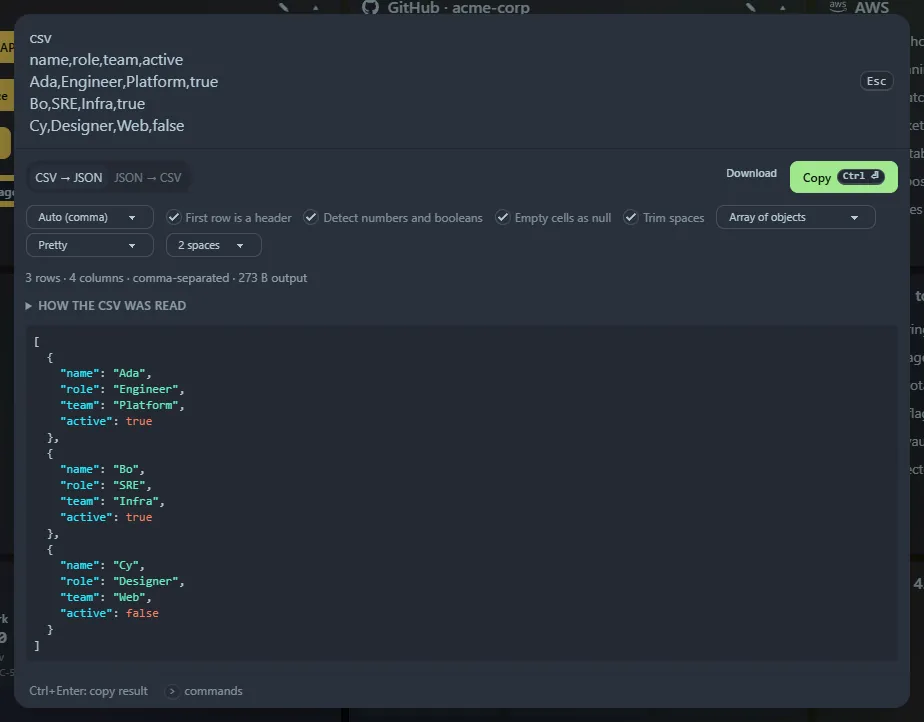

Copy rows from a spreadsheet (they arrive tab-separated) or paste CSV straight into the launcher. Multi-line data where every line has the same number of columns is recognised on its own. You can also type `csv` (or `tsv`) followed by the data.

## CSV → JSON

- **Delimiter**: auto-detects comma, tab, semicolon and pipe, or choose.
- First row is a header, or not.
- **Detect numbers and booleans** (leading zeros like `007` and huge integers stay text).
- Empty cells as `null`, and trim spaces.
- **Shape**: array of objects, array of arrays, or keyed by first column.
- **Output**: pretty (2 or 4 spaces, tabs), minified or **JSON Lines**.

Quoted fields, doubled quotes, line breaks inside quotes, Windows line endings and a byte-order mark are all handled. Duplicate or empty headers are renamed (`a_2`, `column_3`), and ragged rows are reported. A collapsible preview shows how the CSV was read.

## JSON → CSV

Paste JSON after `csv`, or press **→ CSV** in the [JSON formatter](/launcher/json/). An array of objects becomes one row each, with the union of all keys as columns. Nested objects are flattened to `a.b` columns (optional) and arrays are written as JSON text. Choose the delimiter, header row and whether to quote every field.

<kbd>Ctrl</kbd>+<kbd>Enter</kbd> (or **Copy**) copies the result, and **Download** saves `data.json`, `data.jsonl` or `data.csv`.
