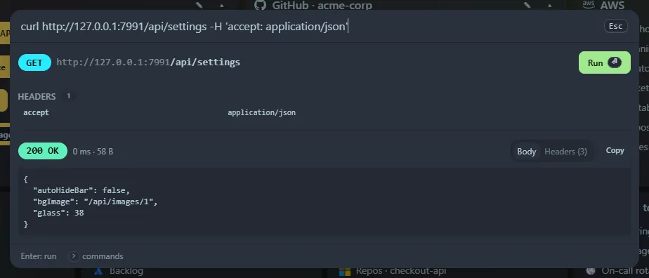

Paste a curl command, for example one copied from **Chrome DevTools → Network → right-click a request → Copy → Copy as cURL (bash)**. The launcher lays it out and, when you press <kbd>Enter</kbd>, runs it and shows the response.

## What you see

- The method and URL.
- **Query parameters** and **headers** as tables. Headers curl would add itself are marked *implied*.
- The **body**, pretty-printed if it is JSON, or a table if it is a form.
- Badges for follow-redirects, insecure TLS, basic auth and timeout.
- After <kbd>Enter</kbd>: a coloured status, the time and size, a **Body** tab (JSON pretty-printed) and a **Headers** tab, and a Copy button.

## Supported options

`-X`, `-H`, `-d` / `--data-raw` / `--data-binary` / `--data-urlencode`, `--json`, `-u`, `-A`, `-e`, `-b`, `-L`, `-k`, `-I`, `-G`, `-m`, `--url`, and bundles like `-sSL`. Multipart forms (`-F`) and `-d @file` show a warning and cannot be run.

The tables are read-only: to change something, edit the command text and the view updates.

## Limits

- Responses over 2 MB are truncated, and binary responses are not displayed.
- Only `http://` and `https://` URLs work. The default timeout is 30 seconds.

## Security

The request is made by the **server**, because browsers cannot call arbitrary sites (CORS). It runs from your machine with your network access, using whatever URL, headers and credentials are in the command.

- The `/api/run` endpoint only accepts requests from this page opened via `localhost` or `127.0.0.1`. Other websites and DNS-rebinding tricks get a `403`.
- Redirects are followed only with `-L`. TLS certificates are checked unless the command has `-k`.
- Commands you run are saved in **Recent**, in your browser, in plain text. Tokens in the command are saved with it.
