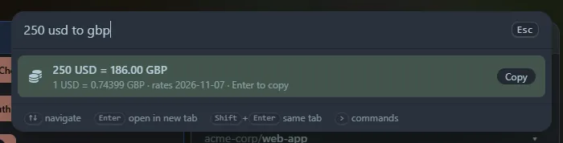

Type an amount, a currency and where to: `100 usd to gbp`, `£50 in eur`, `20 dollars to yen`, or `usd to gbp` for a rate.

## How it works

Rates come from [Frankfurter](https://frankfurter.dev), which publishes central-bank reference rates for about 150 currencies, updated once per working day. Your browser fetches them the first time you type a currency conversion, then **caches them for six hours**, so later conversions are instant. If you are offline it uses the last cached rates and marks the result "(offline, cached)".

## Ways to type it

- Codes: `100 usd to gbp`
- Symbols: `£50 in eur` (`$` means US dollars: use `cad` or `aud` for the others)
- Names: `20 dollars to yen`
- No amount: `usd to gbp` assumes 1
- A calculation as the amount: `2*50 eur to usd`

These are **reference rates**, not trading rates: good for estimating, not for settling invoices.

Units win ties: `10 km to miles` is a [unit conversion](/launcher/units/), and `100 pounds to kg` is weight while `100 pounds to usd` is money.
