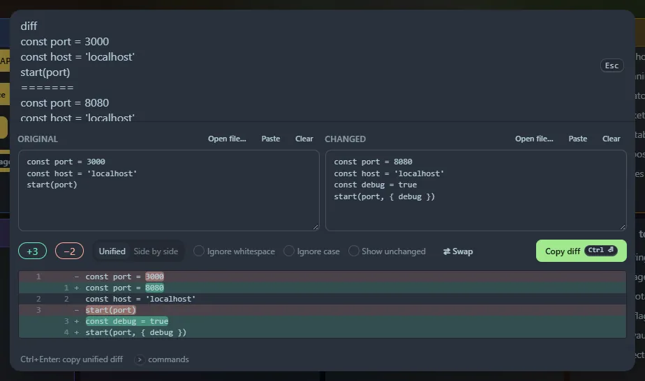

Type `diff` to open two boxes, **Original** and **Changed**, with Paste, Clear and Swap buttons. You can pre-fill both from the launcher: `diff`, the old text, a line containing only `=======` (the git conflict marker), then the new text.

## What you get

- A **line diff** (Myers algorithm) with the **changed words highlighted** inside modified lines.
- **Unified** or **Side by side** view, with long runs of unchanged lines collapsed. Click a "⋯ N unchanged lines" bar to expand it, or tick *Show unchanged*.
- Options to **ignore whitespace** and **ignore case**.
- A `+added −removed` summary, or "Identical".

<kbd>Ctrl</kbd>+<kbd>Enter</kbd> (or **Copy diff**) copies a standard **unified diff** (`---`/`+++`/`@@` hunks with three lines of context) that tools like `patch` and `git apply` understand.

## Limits

Very different texts (more than about 2,000 edits) are shown as a straight replacement instead of being aligned. The on-screen view shows the first 4,000 diff lines; the copied diff includes everything.
