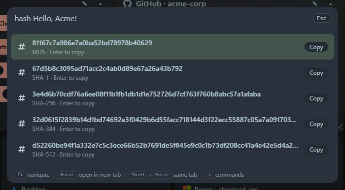

Type `hash <text>` to see MD5, SHA-1, SHA-256, SHA-384 and SHA-512 of the text. `sha256 <text>` or `md5 <text>` shows one algorithm as lower-case hex, UPPERCASE hex and base64. <kbd>Enter</kbd> copies the selected row.

- Text is hashed as UTF-8.
- Trailing spaces and line breaks are ignored.
- Hashing runs in your browser; the text is never sent anywhere.

Copied hashes are saved in **Recent** and reopen with the original text.

:::caution
MD5 and SHA-1 are fine for checksums but are not secure for passwords or signatures. Use a proper password-hashing function for passwords.
:::
