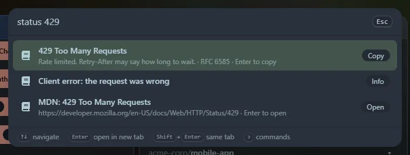

Quick answers to "what does 409 mean?", "what does `Vary` do?" and "what is the MIME type for `.webp`?". The reference is built in, so it works offline.

## Status codes

| Type | Shows |
|---|---|
| `http 404` or `status 404` | The code, what it means, where it is defined, and a link to its MDN page |
| `status 4xx` or `status 4` | Every code of that class, introduced with what the class means |
| `status not found`, `status redirect`, `status rate limit` | Codes whose name or meaning matches, best first |
| `http` | The codes people look up most |

About seventy codes are covered, including the WebDAV ones and a few that are not part of the HTTP standard but common: **499** (nginx) and **520 to 526** (Cloudflare). Those are marked as such.

## Headers

`header content-type` or `headers cache` finds a request or response header by name (case, dashes and spaces do not matter), or by a word from what it does. Each result is a ready-to-copy line with an example value, and says whether it belongs to requests, responses or both. If one header matches, a link to its MDN page is added. About seventy are covered: caching, content negotiation, CORS, cookies, security headers and proxy headers.

## Media types

`mime png`, `mime .json`, `mime image/png` or `mime font` finds the media type for a file extension, or the extensions for a type, or types that match a word. About eighty are covered, including web formats, images, audio, video, documents, archives and fonts. A few types have no file extension, such as `multipart/form-data` and `text/event-stream`.

<kbd>Enter</kbd> copies a row (the MDN rows open the page). The lookups are also widgets: **HTTP status codes**, **HTTP headers** and **MIME types**.
