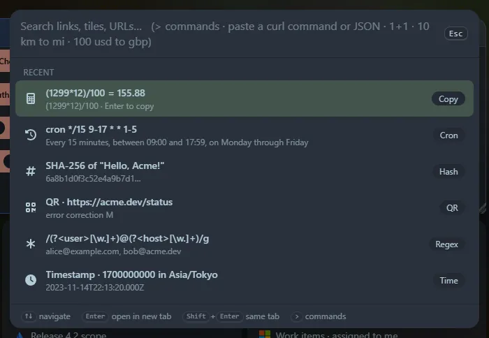

Press <kbd>Ctrl</kbd>+<kbd>P</kbd> (or <kbd>Ctrl</kbd>+<kbd>K</kbd>, or **☰ → Launcher**) from the dashboard. A search box opens in the middle of the page and <kbd>Esc</kbd> closes it. The box grows when you paste several lines.

## How it works

- **Navigate** with <kbd>↑</kbd> <kbd>↓</kbd>. <kbd>Enter</kbd> opens a link in a new tab, <kbd>Shift</kbd>+<kbd>Enter</kbd> in the current tab. Clicking works too.
- With an empty box it shows your **Recent** items. Whatever you copy or run in a tool is added there, and choosing a recent item puts it back in the box so you can use it again.
- Many tools are triggered by **what you type**. If your text does not look like any tool, it is a normal [search](/launcher/search/).
- Some tools show a result list (press <kbd>Enter</kbd> to copy a row). Others open a **panel** that takes over the results area, with its own buttons and options.

## Everything it can do

| Group | Tools |
|---|---|
| **Search and commands** | [Search everything](/launcher/search/) · [Commands](/launcher/commands/) |
| **Calculators and converters** | [Calculator](/launcher/calculator/) · [Units](/launcher/units/) · [Currency](/launcher/currency/) · [Timestamps](/launcher/timestamp/) · [Number bases and bits](/launcher/bases/) |
| **Developer tools** | [Curl runner](/launcher/curl/) · [JSON](/launcher/json/) · [JSON, YAML and TOML](/launcher/yaml/) · [CSV ⇄ JSON](/launcher/csv/) · [Regex](/launcher/regex/) · [Text diff](/launcher/diff/) · [Cron](/launcher/cron/) · [Markdown](/launcher/markdown/) · [chmod and umask](/launcher/chmod/) · [Text case and counts](/launcher/text-case/) |
| **Web and network** | [URL and HTML encoding](/launcher/url/) · [IP and CIDR](/launcher/cidr/) · [HTTP reference](/launcher/http-reference/) · [Open Graph viewer](/launcher/open-graph/) · [Web search](/launcher/web-search/) · [Can I use](/launcher/caniuse/) · [Ping, traceroute and DNS](/launcher/network/) |
| **Security and encoding** | [Password generator](/launcher/password/) · [Hashes](/launcher/hash/) · [Base64](/launcher/base64/) · [UUIDs](/launcher/uuid/) · [JWT decoder](/launcher/jwt/) |
| **Media and design** | [QR codes](/launcher/qr/) · [Colour picker](/launcher/colour/) · [Lorem ipsum](/launcher/lorem/) |

:::tip[Also widgets]
Every tool here (apart from search and commands) can live on your dashboard as a [tool widget](/widgets/tool-widgets/).
:::

## Privacy

The tools run in your browser. Only a few features contact an outside service (currency rates, the Can I use data, and the server-side [curl runner](/launcher/curl/) and [Open Graph viewer](/launcher/open-graph/)), and web search opens the engine you pick; each page says so. See [Privacy and security](/guides/privacy-and-security/).
