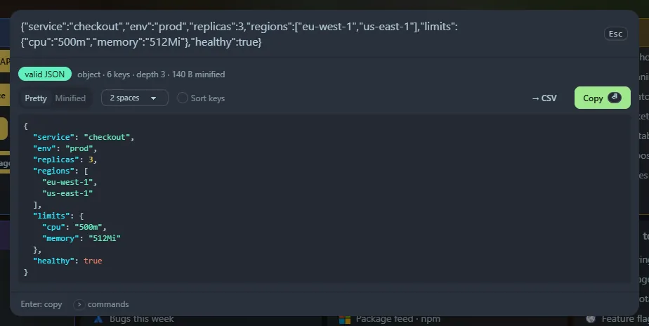

Paste JSON (starting with `{` or `[`). You get pretty-printed, colour-highlighted output. <kbd>Enter</kbd> copies exactly what is shown.

## Options

- **Pretty / Minified**.
- Indent: 2 spaces, 4 spaces or tabs.
- **Sort keys**.
- Stats: type, depth and size.

## It is forgiving

- Comments, trailing commas, single quotes and unquoted keys are accepted. The badge then says "relaxed JSON → fixed".
- JSON that has been encoded as a string (`"{\"a\":1}"`) is unwrapped automatically.
- Errors show the line and column with a caret under the problem.

Short text like `[wip] fix` is not treated as JSON: the error view only appears when the input is clearly meant to be JSON.

## Next to CSV

An **→ CSV** button turns an array of objects into a table: see [CSV ⇄ JSON](/launcher/csv/). Copied JSON up to 20 KB is kept in **Recent**.
