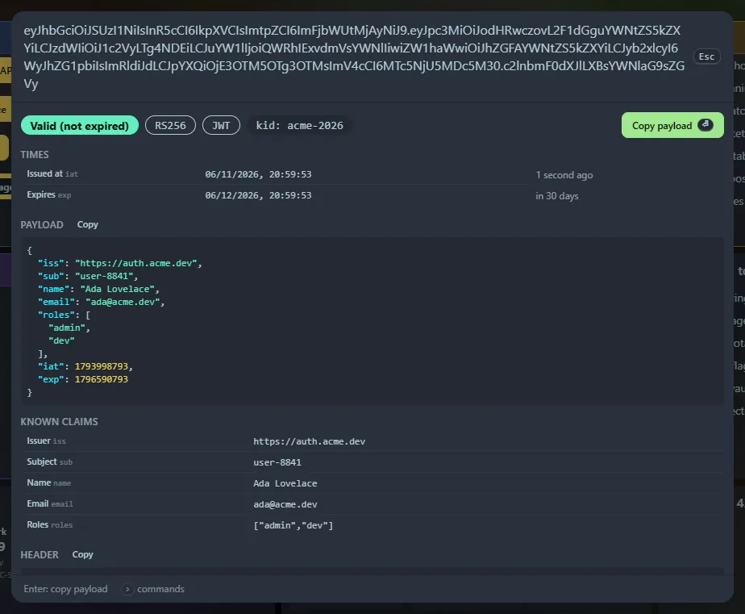

Paste a token, optionally with `Bearer ` or `Authorization: Bearer ` in front. The decoded view appears; <kbd>Enter</kbd> copies the payload.

## What you see

- A status badge: **valid**, **expired**, **not valid yet** or **no expiry**, with the algorithm and key ID.
- **Times** (`iat`, `exp`, `nbf`, `auth_time`) in your local time with relative text such as "2 days ago".
- The **header** and **payload** as highlighted JSON, each with a Copy button, and a table of **known claims** (issuer, subject, audience, name, roles and so on).
- Warnings for unsigned tokens (`alg: none` or an empty signature) and tokens with no expiry.

:::caution[Decoding is not verifying]
Home Screen only **decodes** the token. It does not check the signature (that needs the signing key), so do not treat the claims as trusted. Encrypted tokens (JWE) cannot be read and give an error.
:::

## Privacy

Decoding happens entirely in your browser. The token is not sent to the server. If you copy from the panel, the token is stored in your browser's history so it can appear in **Recent**; clear the site data to remove it.
