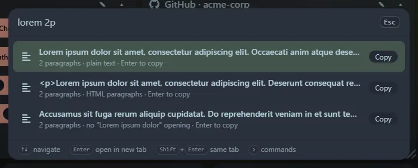

Type `lorem` for quick presets (a sentence, 1, 3 or 5 paragraphs, 10, 50 or 100 words). Ask for an amount with `lorem 50` (that is **words**, like Emmet), `lorem 3p` or `lorem 3 paragraphs`, `lorem 2 sentences` or `lorem 200 chars`.

Each request offers three versions: **plain text**, **HTML** (`
…
` per paragraph) and a version **without the classic "Lorem ipsum dolor sit amet" opening**. The unit can be `w`, `s`, `p` or `c`, or the full word.

- Paragraphs are separated by a blank line, and character counts are exact.
- Limits: 5,000 words, 500 sentences, 100 paragraphs and 20,000 characters.
- <kbd>Enter</kbd> copies. Copied requests appear in **Recent** and generate fresh text when reopened.
