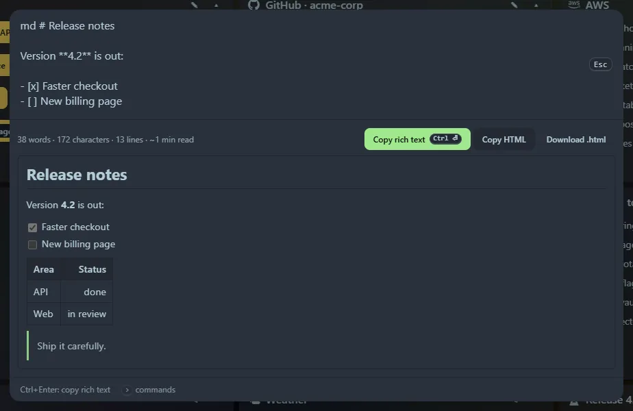

Type `md <markdown>` (or `markdown …`) and the preview renders as you type. Plain `md` offers an example to start from.

## What it renders

GitHub-flavoured Markdown: headings (with working `#anchor` links), bold, italic, ~~strikethrough~~, inline code, fenced and indented code blocks, block quotes, ordered, unordered, nested and **task lists**, tables with column alignment, links, images, horizontal rules and line breaks. A status line shows words, characters, lines and an estimated reading time.

## Copying

- **Copy rich text** (<kbd>Ctrl</kbd>+<kbd>Enter</kbd>): the formatted result goes on the clipboard, so it pastes with its formatting into email, Google Docs or Word, with the plain Markdown as the fallback.
- **Copy HTML**: the markup as text.
- **Download .html**: a standalone page.

## Safe by construction

The Markdown is parsed into a token tree and turned into page elements directly, so **no HTML is ever injected**. Raw HTML in your Markdown (`<script>`, `
`, ``) is shown as text and counted, and links and images with `javascript:` or other unsafe addresses are dropped. Images with `http(s)` addresses are loaded from the internet when previewed. Footnotes and maths are not supported.

Copied documents of up to 40 KB appear in **Recent**.
