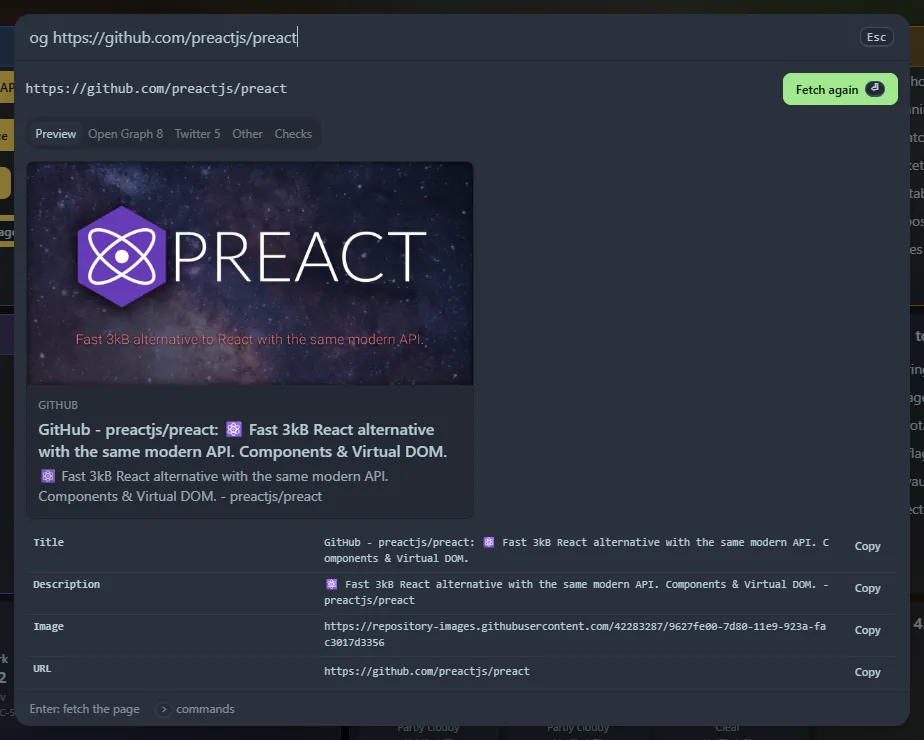

Type `og` and a web address. A panel opens, and when you press <kbd>Enter</kbd> Home Screen fetches the page and shows how it will look when shared in chat apps and on social sites.

## Using it

- `og https://example.com/article` (the scheme is optional: `og example.com` means https).
- Press <kbd>Enter</kbd>, or **Fetch**. Nothing is fetched while you type.
- Tabs: **Preview** (the card, plus title, description, image, address, site and type), **Open Graph** (every `og:`, `article:`, `video:`, `music:` and similar tag), **Twitter** (every `twitter:` tag), **Other** (page title, canonical link, description, robots, theme colour, icons and feeds) and **Checks**.
- **Copy** next to any value copies it. Fetched addresses are saved in **Recent**.

## Checks

A list of what is set and what to improve: whether `og:title`, `og:description`, `og:image`, `og:url` and `og:type` are present, whether the image address is relative or not https, whether the image size and a description for it are given, whether `twitter:card` is set, titles and descriptions that are long enough to be cut, and a canonical link that differs from `og:url`.

## How it works, and what to know

- The page is fetched by **your Home Screen server**, the same way as in the [curl runner](/launcher/curl/), because browsers are not allowed to read other sites. It follows redirects, waits up to 20 seconds, reads up to 2 MB, and checks certificates. It identifies itself as `HomeScreen-OpenGraph`.
- It only works from a page opened via `localhost`, `127.0.0.1` or a name listed in `--allowed-hosts`, like the curl runner. See [Options](/getting-started/options/).
- The **preview picture** is loaded by your browser straight from the site that owns it, after you press Fetch, without sending a referrer.
- Pages built entirely by JavaScript, and sites that refuse requests that do not come from a browser, give little or an error such as `403`. The tags you see are what the server was sent, which is also what most sharing bots see.
- Relative addresses are resolved against the page address (or its `<base>` tag). The address after redirects is not reported by the server.

It is also a widget, **Open Graph viewer**: type the address in its box and press **Fetch**.
