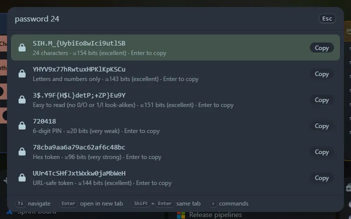

Type `password` (also `pw` or `passwd`). Every option below is a row you can copy with <kbd>Enter</kbd>.

## What you get

- A **strong password**: 20 characters with upper case, lower case, digits and symbols.
- **Letters and numbers only**, for sites that reject symbols.
- An **easy-to-read** one with no `0/O` or `1/l/I` look-alikes.
- A **PIN**, a **hex token** and a **URL-safe token**.

Each shows an **entropy estimate in bits** and a strength label from "very weak" to "excellent".

## Options

Add a length and flags: `password 32`, `pw 16 nosymbols`, `password 24 noupper easy`.

| Flag | Meaning |
|---|---|
| `nosymbols` | no symbols |
| `nonum` | no digits |
| `noupper` | no capital letters |
| `nolower` | no lower-case letters |
| `easy` | no look-alike characters |

Lengths run from 4 to 256. Passwords always contain every character kind you left enabled.

## Privacy

Passwords are generated in your browser with `crypto.getRandomValues` (unbiased sampling). **They are never saved to Recent or anywhere else.**
