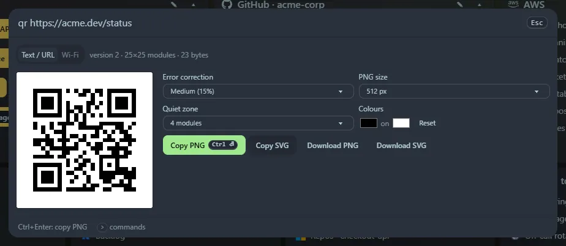

Type `qr <text or URL>` (or `qrcode`). A live code appears.

## Tabs

- **Text / URL** encodes whatever you typed after `qr`.
- **Wi-Fi** takes a network name, password, security type (WPA, WEP or none) and a hidden flag, and makes the code phones read as "join this network".

## Options

- **Error correction** (7 %, 15 %, 25 % or 30 %): more correction survives damage but makes a denser code.
- **PNG size** from 256 to 2048 px, and **quiet zone** (the blank border; 4 modules is the standard).
- **Colours**. Dark on light scans most reliably, and a warning appears for light-on-dark.

## Buttons

**Copy PNG** (<kbd>Ctrl</kbd>+<kbd>Enter</kbd>) copies the image itself, so you can paste it into chat or a document. **Copy SVG** copies the markup. **Download PNG** and **Download SVG** save files.

Text is encoded as UTF-8, so accents, € and emoji scan correctly. It tells you when the data is too long for a QR code (about 2,900 bytes at the lowest error-correction level).

## Privacy

Text and URL codes you copy or download appear in **Recent**. **Wi-Fi codes never do**, because they contain the password.
