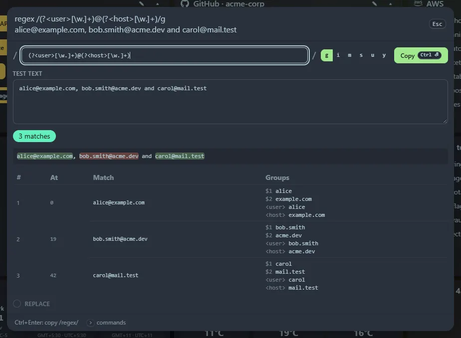

Type `regex` (or `re ` with a space) to open the editor. You can pre-fill it: `re /(\w+)=(\d+)/g a=1, b=2`.

## In the editor

- A pattern box and flag toggles (`g i m s u y`). Hover a flag to see what it means.
- A **test text** box.
- Live results: the text highlighted with each match, and a table of positions, matches and capture groups (numbered and named).
- An optional **Replace** preview with `$1`, `$<name>` and so on.
- <kbd>Ctrl</kbd>+<kbd>Enter</kbd> (or **Copy**) copies `/pattern/flags`, with slashes escaped so it pastes straight into code.

Spaces, tabs and line breaks in matches are shown as `·`, `→` and `↵`. The match count caps at 500, and the table lists the first 100.

## Slow patterns can't freeze the page

Matching runs in a background worker with a 1.5 second limit. A pattern with catastrophic backtracking, such as `(a+)+$` on a long string, shows a warning instead of locking up the page.

Copied regexes are saved in **Recent** and reopen with their pattern, flags and test text.
