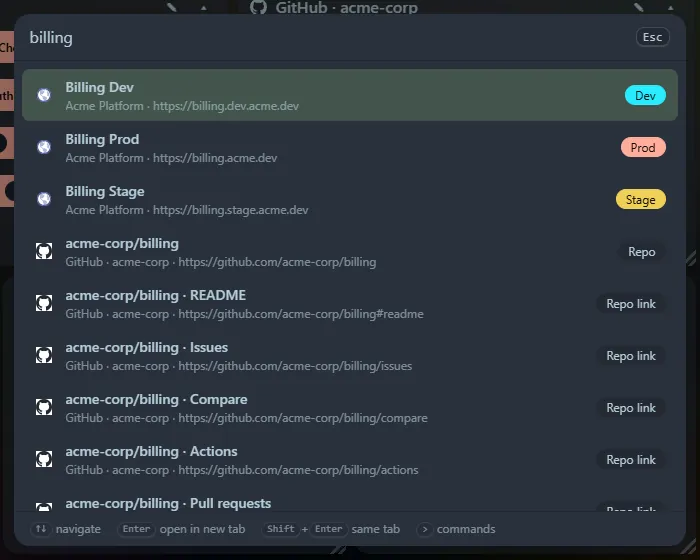

Type to search tile titles, bookmark titles and URLs, developer environment URLs and GitHub repositories, including each repository's quick links. Several words must all match, so `rmal pull` finds `rmalcomber/YouTV · Pull requests`.

## What gets searched

- Tile titles (choosing one scrolls to the tile, opens it if collapsed and flashes it).
- Every link in your bookmark tiles, by title or URL.
- Each developer service environment, shown as `Name Env`.
- Each GitHub repository, plus its README, Compare, Pull requests, Issues and Actions links.

## Keys

| Key | Action |
|---|---|
| <kbd>Enter</kbd> | Open in a new tab |
| <kbd>Shift</kbd>+<kbd>Enter</kbd> | Open in the same tab |
| <kbd>↑</kbd> <kbd>↓</kbd>, <kbd>PageUp</kbd> <kbd>PageDown</kbd> | Move through results |

Results are ranked: matches at the start of a title come first, then matches inside a word, then matches in the URL, then looser fuzzy matches.
