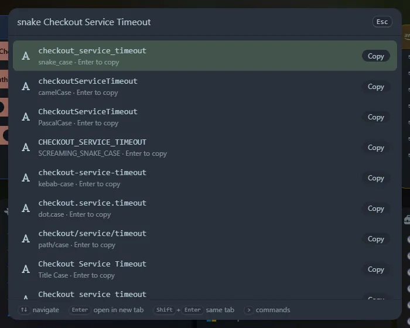

Type a case name and some text, and get the text in every form, with the one you asked for first.

## Case

| Type | First result |
|---|---|
| `camel <text>` | camelCase |
| `pascal <text>` | PascalCase |
| `snake <text>` | snake_case |
| `screaming <text>` | SCREAMING_SNAKE_CASE |
| `kebab <text>` | kebab-case |
| `title <text>` | Title Case |
| `sentence <text>` | Sentence case |
| `upper <text>` / `lower <text>` | UPPER CASE / lower case |
| `slug <text>` (or `slugify`) | A URL slug |
| `case <text>` | Every form, in the usual order |

The text can be a phrase (`checkout service timeout`) or an identifier in any style (`checkoutServiceTimeout`, `CHECKOUT_SERVICE_TIMEOUT`, `checkout-service-timeout`). Words are split at spaces, punctuation, underscores, hyphens and case changes, and runs of capitals stay together (`HTMLParser` is `HTML` and `Parser`). Also shown: `dot.case` and `path/case`.

- **Title Case** keeps short joining words (`a`, `the`, `of`, `and`, `to`...) in lower case, except at the start and end. Spacing and punctuation are kept.
- **Sentence case** puts a capital at the start and after `.`, `!` and `?`.
- **Slugs** remove accents (`é` becomes `e`, `ß` becomes `ss`), turn `&` into `and`, use lower case and join words with hyphens. Letters from other scripts are kept.

## Counts

`count <text>` (or `wc <text>`) lists words, characters, characters without spaces, lines, sentences, paragraphs, bytes in UTF-8, and estimated reading time (200 words a minute) and speaking time (130 words a minute).

<kbd>Enter</kbd> copies a row. The tools are widgets too: **Text case converter** and **Word and line counter**. Nothing you type is sent anywhere.
