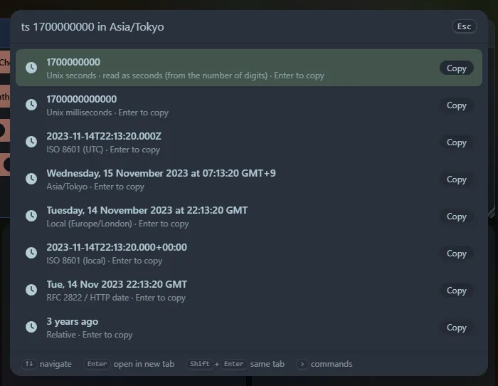

Paste or type a time and see it in every form. Each row is copyable with <kbd>Enter</kbd>.

## What it shows

Unix seconds, Unix milliseconds, ISO 8601 in UTC and in your local zone (with offset), the date in your local zone, the RFC 2822 / HTTP date, and a relative description such as "3 days ago".

## What you can type

- `now` (or `ts`) for the current time.
- A bare number of 9 or more digits, read by length: 10 digits are seconds, 13 are milliseconds, 16 are microseconds, 19 are nanoseconds.
- With the `ts` prefix: any number, decimals, negatives and a unit: `ts 1700000000.5`, `ts 1700000000000 ms`.
- ISO dates: `2026-11-06T12:00:00Z`, `2026-11-06T13:00:00+01:00`, `2026-11-06 12:00`, `2026-11-06`. With no zone it reads **your local time** and also lists the values as if it were UTC.
- Offsets from now: `ts +3d`, `now - 90 minutes`, `ts +1.5h` (units `s m h d w`).
- Other date text with the `ts` prefix is parsed by the browser: `ts Nov 6 2026 12:00 UTC`.
- Add `in <time zone>` for an extra row in that zone: `1700000000 in Asia/Tokyo`.

Copied conversions are saved in **Recent**; reopening one re-runs it, so `now` is the current time again.
