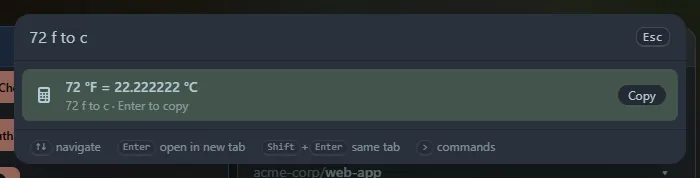

Type a quantity, a separator (`to`, `in`, `as`, `->`, `=>` or `→`) and the unit you want.



```text
10 km to miles
5 ft in cm
100f to c
2h in min
1.5 gb to mb
60 mph to km/h
```

The number can be an expression (`2*5 km to m`), and a unit that is also a separator word works too (`5 in in cm`).

## Units covered

| Category | Units |
|---|---|
| Length | m, km, cm, mm, µm, nm, mile, yard, foot, inch, nautical mile |
| Weight | kg, g, mg, µg, tonne, pound, ounce, stone |
| Volume | l, ml, cl, dl, m³, US and UK gallons, quarts, pints, cups, fl oz, tbsp, tsp |
| Time | ms, s, min, h, day, week, month, year |
| Data | bit, B, KB, MB, GB, TB, PB, and KiB, MiB, GiB, TiB |
| Speed | m/s, km/h, mph, knots, ft/s |
| Area | m², km², cm², hectares, acres, ft², in², yd², mi² |
| Temperature | °C, °F, K |

Names and plurals work (`miles`, `kilos`, `square meters`). Mixing categories, such as `10 km to kg`, shows nothing. A month counts as 30.44 days and a year as 365.25 days.

Copied conversions go into **Recent**.
