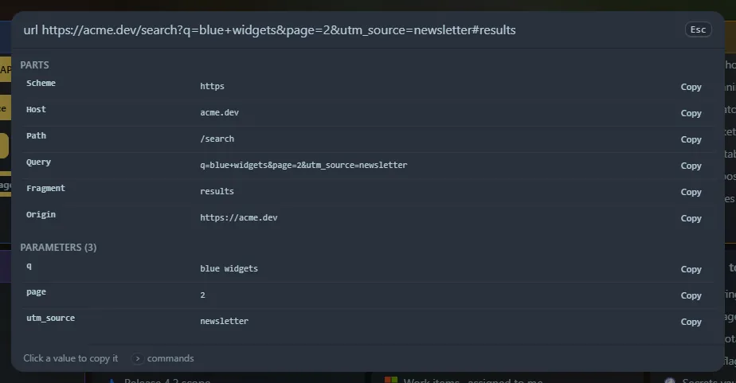

Type `url` followed by some text to encode or decode it. If the text is a URL, or a list of `key=value` pairs, you also get a table of its parts.

## Commands

| Type | You get |
|---|---|
| `url <text>` | URL-encoded and URL-decoded versions, plus a table when the text is a URL or query string |
| `urlencode <text>` / `urldecode <text>` | Only the encoded, or only the decoded, form |
| `html <text>` | HTML-escaped and HTML-decoded versions |
| `htmlencode <text>` / `htmldecode <text>` | Only one direction |
| `qs <url or query string>` | The table only. `query` works too |

<kbd>Enter</kbd> copies the selected row. In the table, click **Copy** next to any value.

## URL encoding

- **Component** encoding (what `encodeURIComponent` does) escapes everything except letters, digits and `- _ . ! ~ * ' ( )`. Use it for a single value inside a URL.
- **Whole URL** encoding keeps `: / ? & = #` so the address still works, and only escapes spaces and other unsafe characters.
- Decoding shows a second version with `+` turned into a space, the way HTML forms write query strings. Text that is not valid percent-encoding (a `%` without two hex digits) is reported instead of being guessed.

## The table

For `https://user:pw@example.com:8080/a%20b?x=1&y=two+words#top` it shows scheme, user, host, port, path, query, fragment and origin, then every parameter decoded. A password is hidden as `••••`. A key that appears more than once is marked **×**. You can paste a query string alone (`?a=1&b=2` or `a=1&b=2`).

## HTML entities

- **Escaping** changes `& < > " '` into `&amp; &lt; &gt; &quot; &#39;`. A second row also writes everything outside plain ASCII as numeric entities (`é` becomes `&#233;`).
- **Decoding** reads numeric (`&#65;`) and hex (`&#x41;`) entities and about forty common named ones (`&nbsp;`, `&copy;`, `&hellip;`, `&mdash;`, arrows, quotes). Names it does not know are left as they are.

Everything is worked out in your browser; nothing you type is sent anywhere. Copied rows are saved in **Recent**. Both tools are also widgets: **URL encoder and parser** and **HTML entities**.
