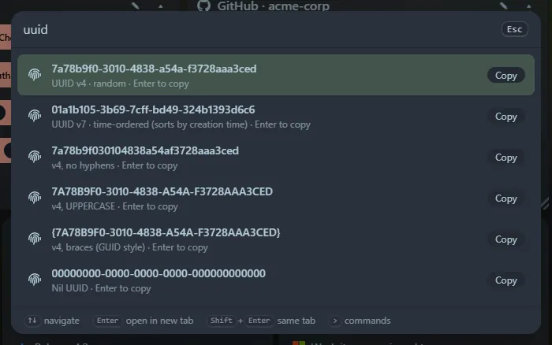

Type `uuid` (or `guid`). Each row is copied with <kbd>Enter</kbd>.

## Generate

- **v4**: a random UUID.
- **v7**: a time-ordered UUID, which sorts by creation time and is handy for database keys.
- The same v4 with no hyphens, in UPPERCASE and in `{BRACES}` (GUID style), plus the nil UUID.
- `uuid 5` (any number from 1 to 100) gives that many at once, one per line.

## Inspect

`uuid <existing uuid>` shows the **version**, the variant and, for v1, v6 and v7 UUIDs, the **time it was created**, and offers the lower-case, UPPERCASE, no-hyphen and braces forms. Hyphens are optional and `{braces}` and `urn:uuid:` are accepted.

UUIDs use the browser's secure random generator. A single copied UUID is saved in **Recent** (and reopens as an inspection); batches are not.
