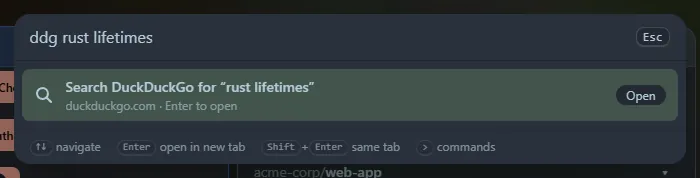

Type the name of an engine, then what to search for, and press <kbd>Enter</kbd>. The search opens in a new tab (<kbd>Shift</kbd>+<kbd>Enter</kbd> uses the current one).

`google rust lifetimes` opens Google with that search. `search rust lifetimes` lists every engine, so you can choose.

## The engines

| Words | Opens |
|---|---|
| `google`, `g` | Google |
| `bing` | Bing |
| `duckduckgo`, `ddg` | DuckDuckGo |
| `brave` | Brave Search |
| `ecosia` | Ecosia |
| `startpage` | Startpage |
| `yahoo` | Yahoo |
| `kagi` | Kagi |
| `images`, `gimages` | Google Images |
| `maps`, `gmaps` | Google Maps |
| `translate` | Google Translate (to English) |
| `youtube`, `yt` | YouTube |
| `wikipedia`, `wiki` | Wikipedia (English) |
| `github`, `gh` | GitHub |
| `stackoverflow`, `so` | Stack Overflow |
| `mdn` | MDN Web Docs |
| `npm` | npm |
| `crates`, `cratesio` | crates.io |
| `docsrs` | docs.rs |
| `pypi` | PyPI |
| `reddit` | Reddit |
| `hn`, `hackernews` | Hacker News (Algolia search) |
| `amazon` | Amazon (amazon.com) |
| `imdb` | IMDb |
| `wolfram`, `wa` | Wolfram Alpha |

## Good to know

- The search text must come after the word: `google` alone does nothing, and the word must be the first thing you type.
- Home Screen only builds the address. The search engine sees what you search for when the new tab opens, as with any search. Nothing is sent before you press Enter.
- The text is encoded safely, so `c++ & rust` and characters such as `#` and `&` reach the engine as typed.
- Opened searches are saved in **Recent**, so you can repeat them.

The tool is also a widget, **Web search**: type what to look for and click an engine. The list of engines is built in; custom engines may come later.
