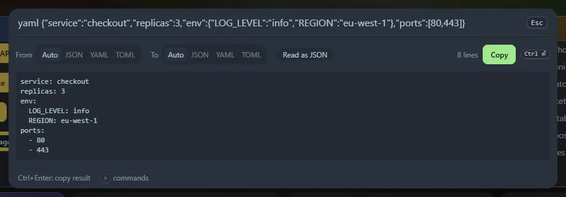

Paste a document after `yaml` or `toml`. Home Screen works out what you pasted and converts it: JSON or TOML becomes YAML, and YAML becomes JSON (for `yaml`); JSON or YAML becomes TOML, and TOML becomes JSON (for `toml`).

## Commands

| Type | Meaning |
|---|---|
| `yaml <text>` or `yml <text>` | Convert to YAML, or from YAML to JSON |
| `toml <text>` | Convert to TOML, or from TOML to JSON |
| `json2yaml`, `yaml2json`, `json2toml`, `toml2json`, `yaml2toml`, `toml2yaml` | Choose both formats |

The panel shows **From** and **To** tabs, so you can override the guess. **Read as …** tells you what was detected. <kbd>Ctrl</kbd>+<kbd>Enter</kbd> (or **Copy**) copies the result.

## How the format is detected

JSON is tried first. Then, if the text has `key = value` lines or `[table]` headers, TOML. Otherwise YAML. JSON with comments, trailing commas or unquoted keys is read leniently, as in the [JSON formatter](/launcher/json/). When a document is not valid, the message names the line.

## What YAML it reads

Configuration-style YAML: nested maps and lists, `- key: value` items, plain, `'single'` and `"double"` quoted text (also across lines), `[flow, lists]` and `{flow: maps}`, `|` and `>` block text with `-`, `+` and indent indicators, comments, a leading `---` and a trailing `...`.

Values follow **YAML 1.2**: `null`, `~` and empty are null, `true` and `false` are booleans, numbers (decimal, `0x`, `0o`, floats) are numbers, and everything else is text. So `yes`, `no` and `on` stay text. Integers too big to keep exactly stay text.

It stops with a message and a line number on things it does not support: **anchors, aliases, tags** (`&a`, `*a`, `!!str`), **merge keys** (`<<`), complex `?` keys, **several documents** in one file, tabs used as indentation, duplicate keys, and long plain text that continues on the next line (use quotes, `|` or `>`).

## What it writes

YAML with a two-space indent. Text that could be read as another type (`true`, `123`, `2024-01-01`, `a: b`, empty text) is quoted. Text with line breaks becomes a `|` block.

TOML is written with simple values first, then `[tables]` and `[[arrays of tables]]`. TOML has **no null**: null values are left out and the panel warns you which ones. A TOML document must be a map at the top, so a JSON list cannot be converted to TOML. Dates and times in TOML are kept as text. `inf` and `nan` become the words `Infinity` and `NaN` in JSON.

Everything runs in your browser. The tool is also a widget, as **JSON ⇄ YAML converter** and **JSON ⇄ TOML converter**, and copied conversions are saved in **Recent**.
