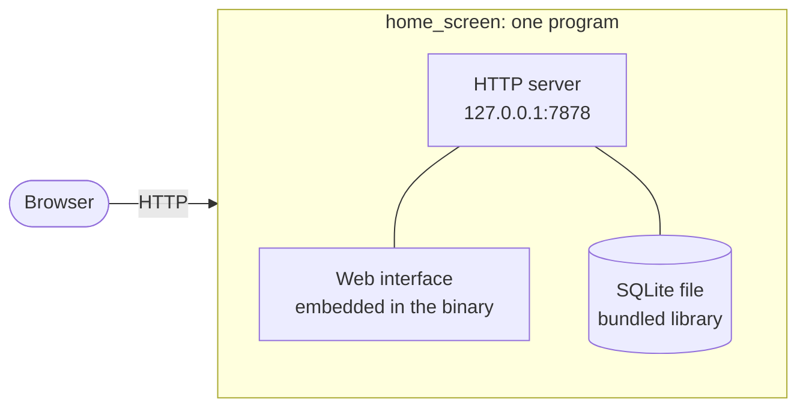

Home Screen is a small Rust server with the web interface compiled into it. This page lists what is inside and how the pieces fit.

## The shape of it



There is no separate web server, no Node.js at run time and no database service to install.

## Server (Rust)

| Piece | Used for |
|---|---|
| **`std::net`** (our own `server.rs`) | The HTTP/1.1 server: one thread per connection, keep-alive, strict limits. About 400 lines instead of an async web framework. See [Binary size](/reference/binary-size/) |
| **rusqlite** (bundled SQLite) | The database. SQLite is compiled in, so nothing is installed, with the optional parts (full-text search, R-tree, JSON, extension loading and more) switched off |
| **`build.rs`** | Embeds the web interface: the web build leaves a gzip copy of each file, and the server sends those bytes unchanged with `Content-Encoding: gzip`, so the program needs no decompressor |
| **serde** / **serde_json** | JSON for the API |
| **`http_client.rs`** + **native-tls** | The curl runner's outgoing requests: our own small HTTP/1.1 client over `native-tls`. Windows uses schannel and macOS uses Security.framework (the operating system's own TLS and certificate store); on Linux, OpenSSL is compiled in, so the Linux binary is static |

The server has {{metric.direct_deps}} direct dependencies and {{metric.crates}} crates in total. It is about {{metric.rust_loc}} lines of Rust.

## Web interface

| Piece | Used for |
|---|---|
| **Preact** + **@preact/signals** | The UI, in a tiny runtime |
| **Tailwind CSS 4** + **DaisyUI 5** | Styling and components, with the `dim` theme |
| **Vite 6** | Build tool |
| **marked** | Parses Markdown tokens for the previewer (it never produces HTML) |
| **qrcode-generator** | QR code encoding |

Only {{metric.runtime_npm}} npm packages ship in the web interface. The rest of the launcher, from the calculator and unit converter to the cron parser, diff, regex and colour maths, is written in plain JavaScript in this repository: about {{metric.web_loc}} lines.

### Core and extensions

The web source is split in two. `web/src/core/` is the app itself: the grid, tile editor, launcher window and state. `web/src/extensions/` holds {{metric.extensions}} extensions, one folder each, that provide the {{metric.widgets}} widgets and {{metric.tools}} launcher tools. Each extension has a manifest, an entry, and an engine of pure functions. The build makes every extension its own file, and the browser fetches it the first time a tile or the launcher needs it, so a dashboard of notes and bookmarks never downloads the cron parser, the QR encoder or the Markdown tokenizer. All the files are still embedded in the program. How to add one: [Extending Home Screen](/reference/extending/).

## How it is built

On Windows, `build.ps1` does two things (on Linux and macOS you run the same two commands by hand):

1. `npm ci && npm run build` in `web/` produces the web interface (`web/dist`).
2. `cargo build --release` compiles the server and embeds those files.

The result is copied to `dist\home_screen.exe`. Releases for every platform are built by GitHub Actions; see [Releasing](/reference/releasing/). The release profile is tuned for size:

```toml
[profile.release]
opt-level = "z"     # optimise for size
lto = true          # link-time optimisation
codegen-units = 1
panic = "abort"
strip = true        # no debug symbols
```

A clean release build takes about {{metric.build_time}} on the [measurement machine](/reference/metrics/#how-these-were-measured).

## Tests

{{metric.tests_total}} automated tests run on every change: {{metric.web_tests}} in Vitest (parsers, converters, the launcher engines, widgets) and {{metric.rust_tests}} in Rust (the database layer and SVG sanitiser). The QR generator is checked by decoding its output with an independent QR reader.

## Outside services at run time

Only when a feature is used, and only from your browser: Iconify (icons), Google's favicon service (link icons), Open-Meteo (weather) and Frankfurter (currency rates). Everything else works offline. See [Privacy and security](/guides/privacy-and-security/).

## This documentation

The site you are reading is built with [Astro](https://astro.build) and its Starlight theme from Markdown files in the `docs/` folder of the repository. The screenshots are generated by a script from a fictional workspace and stored as WebP.
