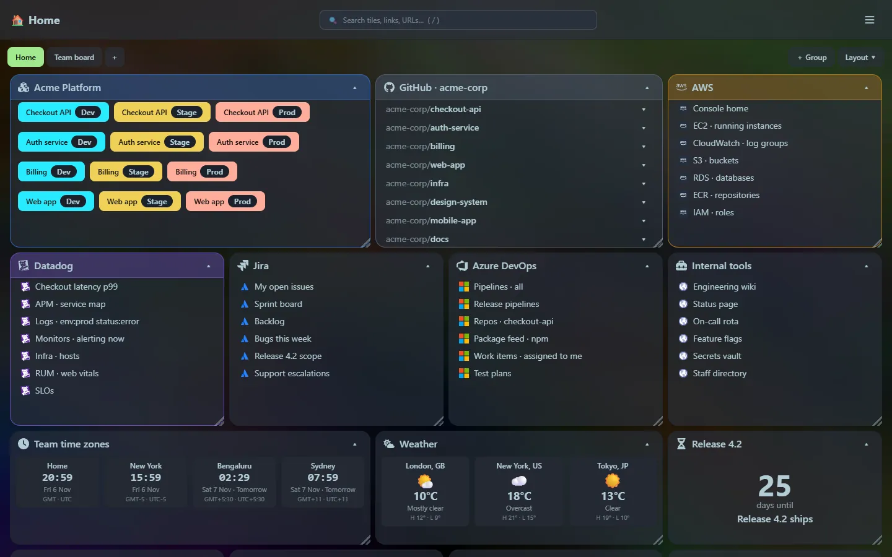

**First public beta.** Everything described in these docs is in this release unless a page is marked *Provisional* (locked mode is not in the program yet).

[View this release on GitHub]({{releases}}/tag/v{{version}})

## Highlights

- A **dashboard of tiles** you drag, resize and collapse: bookmarks, developer environments (Prod is always red), GitHub repositories and widgets.
- A **launcher** (<kbd>Ctrl</kbd>+<kbd>P</kbd>) that searches everything and includes {{metric.tools}} tools: calculator, unit and currency converters, timestamps, curl runner, JSON, CSV, regex, diff, cron, Markdown, password, hash, base64, UUID, JWT, QR codes, colour picker and lorem ipsum.
- **{{metric.widgets}} widgets** from a categorised gallery, including every launcher tool, plus multi-zone clocks and multi-place weather with list or mini-tile layouts.
- **Chrome bookmark import**, icons from thousands of sets or your own SVG, and a background image with an adjustable glass effect.
- **Private and local**: listens on `127.0.0.1` by default, no accounts, one SQLite file.
- **Runs anywhere**: Windows, Linux and macOS builds, and an Alpine Docker image with Compose files, including one with Caddy, HTTPS and basic authentication.

## The binary

| | |
|---|---|
| Executable | {{metric.exe_size}} ({{metric.exe_gzip}} compressed) |
| Start-up | {{metric.startup}} |
| Memory at rest | {{metric.idle_memory}} |
| Tests | {{metric.tests_total}} passing |
| Built with | Rust, axum, SQLite (bundled), Preact, Tailwind CSS and DaisyUI |

See [Metrics](/reference/metrics/) and [Tech stack and build](/reference/tech-stack/).

## Downloads

Attached to the [GitHub release]({{releases}}), with a `SHA256SUMS` file:

| Platform | File |
|---|---|
| Windows (64-bit) | `home_screen-v{{version}}-windows-x64.zip` |
| Linux (Intel/AMD 64-bit) | `home_screen-v{{version}}-linux-x64.tar.gz` |
| Linux (Arm 64-bit) | `home_screen-v{{version}}-linux-arm64.tar.gz` |
| macOS (Apple silicon) | `home_screen-v{{version}}-macos-arm64.tar.gz` |
| macOS (Intel) | `home_screen-v{{version}}-macos-x64.tar.gz` |
| Docker (Intel/AMD and Arm) | `ghcr.io/rmalcomber/home_screen:{{version}}` |

See [Install](/getting-started/install/) and [Docker](/getting-started/docker/). The macOS builds are not signed or notarised yet.

## Known limitations

- It is a beta: features, the database layout and the HTTP API may change.
- There is no sign-in. It listens on your machine only; see [Privacy and security](/guides/privacy-and-security/).
- Icons, favicons, weather and currency rates need internet access.
- Footnotes and maths are not supported in the Markdown previewer; multipart forms are not supported in the curl runner.

## What is next

See the [roadmap](/roadmap/).
