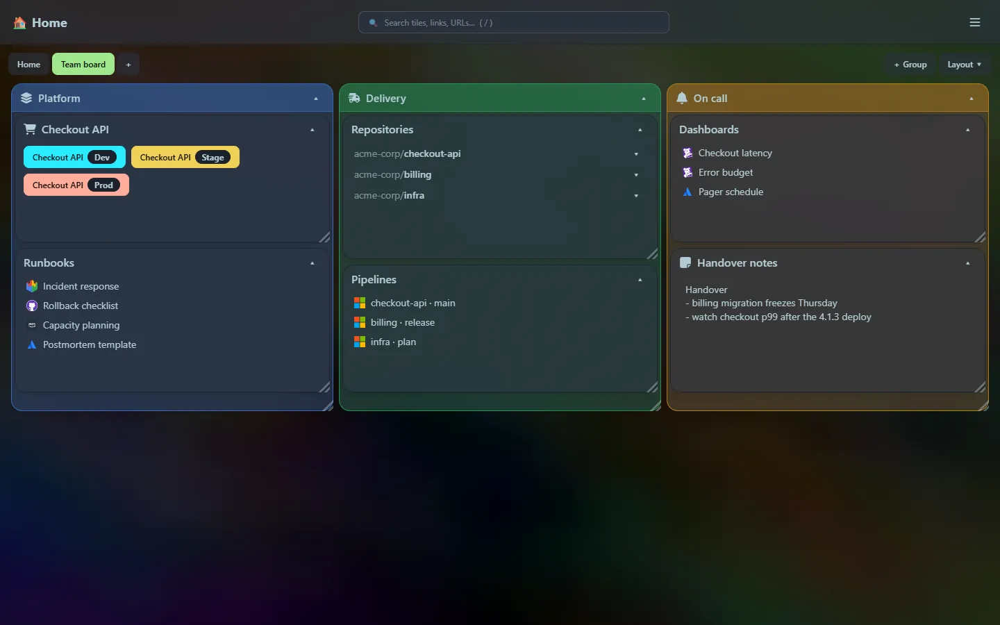
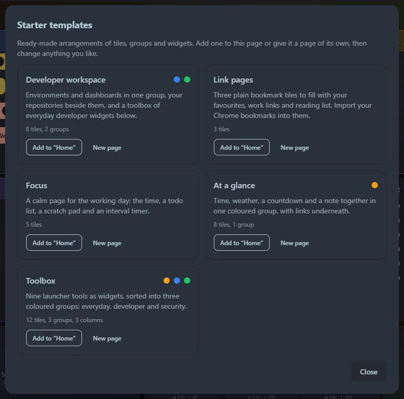

:::note[Unreleased]
This page describes the next release. It is published on the day the release is, and the documentation already covers the features below.
:::

**A UI overhaul.** Home Screen can now organise a lot more tiles without becoming a mess.

## What is new

- **Groups.** A coloured box that holds other tiles, with its own grid. It moves, resizes and collapses as one, and tiles drag in and out of it. [Groups and colours](/guides/groups-and-colours/)
- **Colours for every tile.** Eleven theme-matched accents tint a tile's title bar and border, and turn a group into a tinted box.
- **Layout modes.** Besides the free grid, a page can be split into 2, 3, 4 or 6 equal columns. [Layout](/guides/layout/#layout-modes)
- **Auto-arrange.** Sort A–Z, group by type, balance into columns, reset tile sizes, collapse or expand everything: one click each, from the new **Layout** menu or the launcher. [Arrange now](/guides/layout/#arrange-now)
- **Pages.** Several dashboards as tabs, each with its own tiles and layout mode. The launcher searches all of them. [Pages](/guides/pages-and-templates/)
- **Starter templates.** Developer workspace, Link pages, Focus, At a glance and Toolbox, offered on every empty page and from the Layout menu. [Templates](/guides/pages-and-templates/#starter-templates)
- **A quieter title bar.** The edit button now appears only when you point at the title bar (always shown on touch screens).
- **Smarter new tiles.** New tiles go to the shortest column in column modes, and into the group you add them from.

## Upgrading

- **Your database upgrades itself** the first time the new version starts: the new columns are added in place, your tiles keep their positions, and everything lands on a first page called *Home*. Back up `home_screen.db` first anyway, as for any upgrade: see [Data and backup](/guides/data-and-backup/).
- **Going back is one-way.** An older version ignores the new columns, so it shows your tiles but not your pages, groups or colours. Keep the backup if you may roll back.
- The HTTP API gains pages, and tiles gain `color`, `parent_id` and `page_id`. See the [HTTP API](/reference/http-api/).

## Numbers

| | |
|---|---|
| Executable | {{metric.exe_size}} ({{metric.exe_gzip}} compressed) |
| Tests | {{metric.tests_total}} passing |

See [Metrics](/reference/metrics/).
