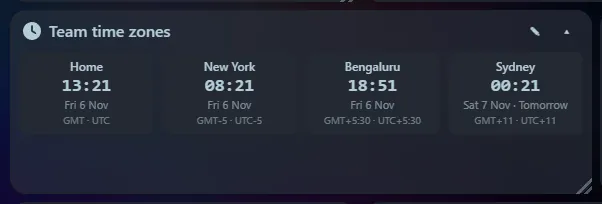
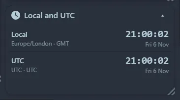

Shows your local time, or any number of **time zones in one tile**. Each zone shows its name, IANA zone, abbreviation and UTC offset. With several zones, a zone whose date differs from yours is marked "Tomorrow" or "Yesterday".

## Settings

- **Time zones**: leave the zone blank for your local time, or type an IANA name such as `Europe/London` (the box suggests names as you type). Name each zone however you like.
- **Quick add**: one click adds popular zones (UTC, London, New York, Los Angeles, Paris, Dubai, Mumbai, Tokyo, Sydney).
- **Layout when there is more than one**: a stacked **List** or side-by-side **Mini tiles**.
- 12-hour or 24-hour clock, and seconds on or off.

## Two layouts

**List** gives one row per zone with a larger time. **Mini tiles** lay the zones out side by side and wrap onto further rows when the tile is narrow, which is ideal for a wide, short tile along the top of the page. With a single zone the widget shows one large clock.
