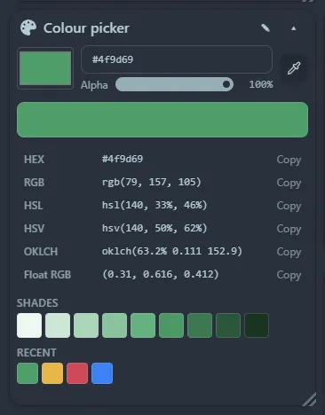

The same tool as the [launcher's colour picker](/launcher/colour/), in a tile: a colour picker with an **eyedropper** (sample any colour on your screen), hex entry (also `rgb()`, `hsl()` and colour names), an alpha slider, every format ready to copy (HEX, RGB, HSL, HSV, OKLCH, float RGB) and a row of shades.

Click a format to copy it. Copied colours are kept in a **Recent** row, and the working colour is saved with the tile.
