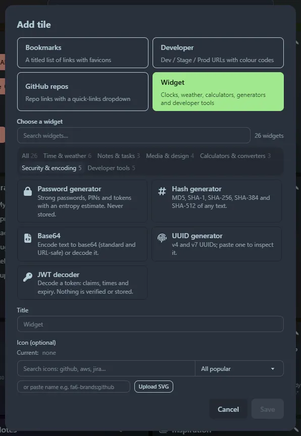

A **widget** is a tile that does something rather than listing links. Add one from **☰ → ＋ Add tile → Widget**.

## The gallery

A picker lists every widget with an icon and a one-line description. Browse by category or search across all of them. Picking one fills in the **title and icon** for you (type or choose your own to override) and shows that widget's settings, if it has any, underneath.

## All {{metric.widgets}} widgets

| Category | Widgets |
|---|---|
| **Time and weather** | [Clock](/widgets/clock/) · [Weather](/widgets/weather/) · [Countdown](/widgets/countdown/) · [Tabata timer](/widgets/tabata/) · Timestamp converter · Cron explainer |
| **Notes and tasks** | [Notes](/widgets/notes/) · [Todo list](/widgets/todo/) · Markdown previewer |
| **Media and design** | [Image carousel](/widgets/carousel/) · [Colour picker](/widgets/colour-picker/) · QR code generator · Lorem ipsum |
| **Calculators and converters** | Calculator · Unit converter · Currency converter |
| **Security and encoding** | Password generator · Hash generator · Base64 · UUID generator · JWT decoder |
| **Developer tools** | Curl runner · JSON formatter · Regex tester · Text diff · CSV ⇄ JSON |

The ones without a link are [tool widgets](/widgets/tool-widgets/): the launcher tool of the same name, hosted in a tile.

## Sizes and layout

Each widget has a sensible default size. Resize and move it like any tile: see [Layout](/guides/layout/). The clock and weather widgets can show several zones or places as a list or as mini tiles.
