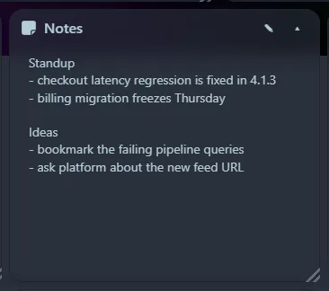

A plain-text scratch pad. Type directly in the tile; it saves when you click away. It is stored in the database with the rest of your dashboard, so it is included in your [backup](/guides/data-and-backup/).

For something with formatting, try the [Markdown previewer](/launcher/markdown/), which is also available as a [tool widget](/widgets/tool-widgets/).
